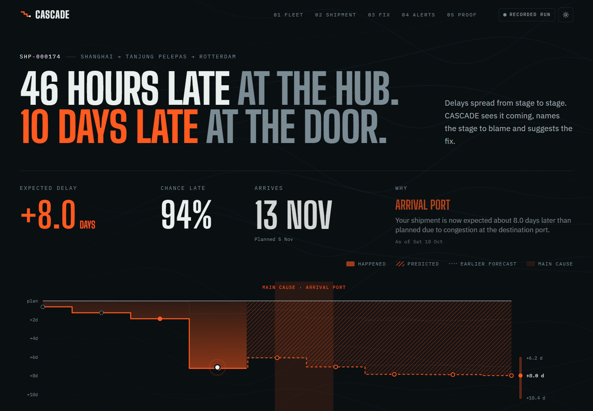
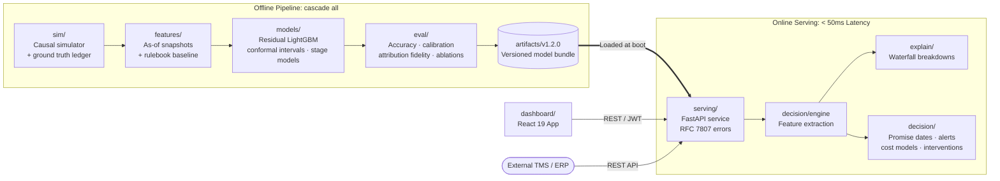

# CASCADE: Stage-Aware Shipment ETA & Delay Propagation

Container shipping delays rarely happen in isolation—a small 4-hour delay at origin departure can cause a missed transshipment connection at a hub port, turning a minor hiccup into a 7-day backlog.

**CASCADE** (Causal-Aware Stage-Chained Arrival & Delay Estimator) predicts when container shipments will actually arrive, evaluates late delivery risks, and pinpoints exactly **which stage of the journey is causing the delay**. Rather than outputting raw timestamps, CASCADE powers operational decision-making: dependable customer promise dates, automated risk alerts, financial cost-of-delay calculations, and ranked corrective actions.

> **Technical Report (PDF):** [`report/CASCADE_Technical_Report.pdf`](report/CASCADE_Technical_Report.pdf) · **Docs Index:** [`docs/`](docs/README.md)



---

## Key Highlights

- **37% Error Reduction**: Outperforms standard carry-forward baselines across peak-season test voyages.
- **Physics + Machine Learning**: Combines an operator-rulebook physics projection for baseline voyage progress with LightGBM quantile regression models to learn real-world corrections and uncertainties.
- **Calibrated Arrival Windows**: Conformal P10–P90 prediction intervals adapt dynamically at each milestone, narrowing from initial booking to final delivery.
- **Root-Cause Attribution**: Every delay is linked to underlying bottlenecks (berth congestion, transshipment missed sailings, customs holds, rail cutoffs).
- **Sub-3ms Inference**: Fast, in-process prediction and explanation latency designed for high-throughput operational systems.

<!-- RESULTS:START -->
| Metric (out-of-time test, 20 voyages / 62 shipments / 725 snapshots) | Primary Seed | 5-Seed Average |
|---|---|---|
| ETA Error (MAE, final delay) | **24.5 h** vs 38.6 h baseline | 26.1 h ± 4.1 h |
| Improvement vs Carry-Forward Baseline (B1) | **37%** (95% CI 25%–48%) | 28% ± 6% |
| Improvement vs Propagation Prior (B2) | 30% | 22% ± 7% |
| P10–P90 Interval Coverage (Nominal 80%) | 81% | 81% ± 2% |
| Delay Risk ($P(\text{late} > 24\text{ h})$): Brier · PR-AUC | 0.185 · 0.85 | 0.165 ± 0.019 · 0.87 ± 0.02 |
| Root-Cause Stage Attribution (Top-1 · Top-2) | 42% · 68% | 47% ± 4% · 68% ± 3% |
| Latency p95 (Predict + Explain) | 2.4 ms | 2.3 ms ± 0.3 ms |
<!-- RESULTS:END -->

---

## Quick Start

A pre-trained model bundle (`artifacts/v1.2.0`) is included in the repository, so you can explore the application immediately without running training steps.

### Local Setup

```bash
# 1. Create and activate a Python 3.12 virtual environment
uv venv --python 3.12
# On Linux/macOS:
source .venv/bin/activate
# On Windows:
.venv\Scripts\activate

# 2. Install dependencies
uv pip install -e ".[ui,dev]"

# 3. Start the FastAPI service (http://127.0.0.1:8000/docs)
cascade serve
```

In a second terminal, launch the dashboard:

```bash
cd dashboard
npm install
npm run dev
# Dashboard opens on http://localhost:5173
```

> **Tip:** If the `cascade` command is blocked by your shell policies, run `python -m cascade.cli serve` directly.

### Running with Docker

You can also run the entire stack (API, React Dashboard, and Streamlit) with a single Docker Compose command:

```bash
docker compose -f docker/compose.yaml up --build
```

- **React Dashboard:** http://localhost:8080
- **API Documentation:** http://localhost:8000/docs
- **Streamlit Control Tower:** http://localhost:8501

---

## User Interfaces & Demo Accounts

### 1. Operations Dashboard (React 19 + Tailwind CSS)
Designed for dispatchers and logistics planners. Includes an interactive fleet map, checkpoint time-travel replay, stage delay waterfalls, what-if intervention labs, and risk alerts. It also includes an offline demo fallback if the backend API is disconnected.

### 2. Streamlit Control Tower
Designed for data scientists and operations analysts. Displays model internals, calibration curves, drift tracking, and feed health diagnostics (`streamlit run app/Home.py`).

### Demo Accounts

The dashboard features one-click demo logins on the sign-in screen (password for all accounts is `cascade-demo`):

| Account | Role | Landing View |
|---|---|---|
| `priya` | Operations Planner | Fleet overview, prioritized by highest delay risk |
| `marco` | Customer Support | Single shipment detail with plain-language customer messaging |
| `lena` | Network Analyst | Proof & validation metrics (error distributions, delay propagation) |
| `reviewer` | Reviewer | Guided walkthrough of an at-risk shipment journey |

---

## How It Works

### The Shipment Stage Graph

Container journeys follow a sequential stage graph. Direct routes skip intermediate hub legs:

```
Origin Gate-In ➔ Departure ➔ (Hub Arrival ➔ Hub Departure) ➔ Dest Arrival ➔ Discharge ➔ Customs ➔ Gate-Out ➔ Delivery
```

- **Observed Delay:** Current elapsed delay relative to the original planned milestone.
- **Stage Increment ($\Delta_k$):** Delay gained or absorbed during a specific stage.
- **Remaining Delay ($\hat{R}_q$):** Predicted future delay from the current milestone through final delivery.
- **Nowcasting:** Predictions are evaluated strictly as-of each checkpoint, using only the telemetry and forecasts available at that timestamp.

### Architecture



---

## API Usage Example

Fetch an ETA prediction and delay explanation for a shipment:

```bash
# 1. Download a sample payload for shipment SHP-000174
curl -s http://127.0.0.1:8000/v1/shipments/SHP-000174/payload > payload.json

# 2. Query the prediction endpoint
curl -s -X POST http://127.0.0.1:8000/v1/predict \
  -H "Content-Type: application/json" \
  -d @payload.json
```

Example response:

```json
{
  "shipment_id": "SHP-000174",
  "checkpoint": "AFTER_DEPART_TS",
  "eta": { "p10": "2026-11-04T12:00:00Z", "p50": "2026-11-07T18:00:00Z", "p90": "2026-11-10T06:00:00Z" },
  "delay_hours": { "observed": 12.0, "p50": 240.0 },
  "p_late": 0.99,
  "risk_tier": "LATE",
  "root_cause_group": "PORT",
  "narrative": "Expected 10.0 days late. Primary driver: Destination port berth congestion forecast at 93% capacity.",
  "waterfall": [ ... ],
  "cost_usd": { "p50": 3450.0 }
}
```

Interactive OpenAPI documentation is available at `http://127.0.0.1:8000/docs`.

---

## Screenshots

| | |
|---|---|
| <br>**Shipment Deep Dive:** ETA distribution, risk tier, promise date, cost breakdown, and narrative explanation. | <br>**Delay Waterfall:** Step-by-step contribution of realised and projected stage delays. |
| <br>**Intervention Simulator:** Test the impact of berth overrides, priority discharge, or expedited drayage. | <br>**Disruption Radar:** Simulate weather events or port strikes across affected fleet shipments. |

---

## Testing & Code Quality

```bash
# Run unit and API contract tests
pytest -q -m "not perf"

# Run latency budget benchmark tests
pytest -q -m perf

# Formatting and linting
ruff check src tests app && ruff format --check src tests app

# Static type check and architectural layer linting
mypy && lint-imports
```

Automated CI workflows ([`.github/workflows/ci.yml`](.github/workflows/ci.yml)) validate formatting, type safety, test suites, and end-to-end integration across both Linux and Windows runners.

---

## Documentation

| Document | Description |
|---|---|
| [Technical Report (PDF)](report/CASCADE_Technical_Report.pdf) | Formal project overview, design decisions, and empirical benchmark findings |
| [docs/PRD.md](docs/PRD.md) | Product requirements, operational personas, and objective metrics |
| [docs/Architecture.md](docs/Architecture.md) | System components, data pipelines, fallback chains, and design records |
| [docs/Design.md](docs/Design.md) | Simulator mechanics, feature engineering, and model contracts |
