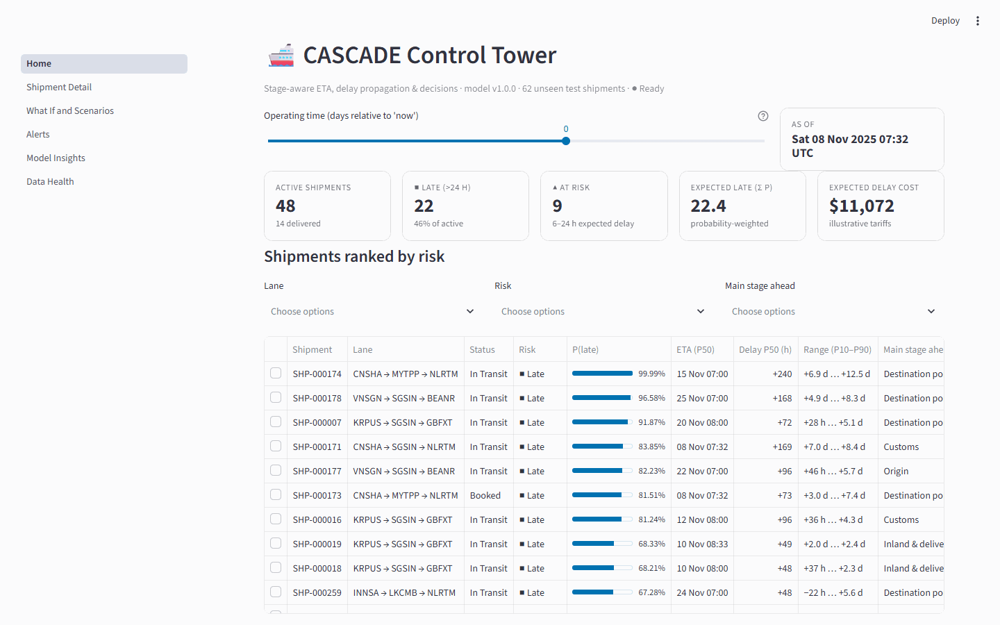
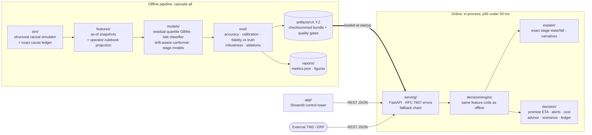
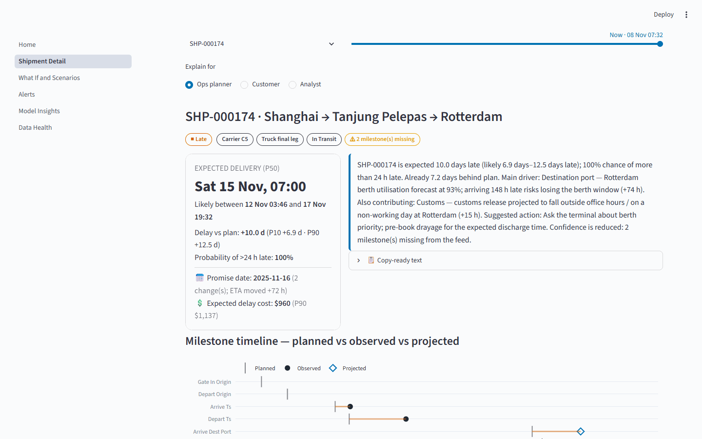
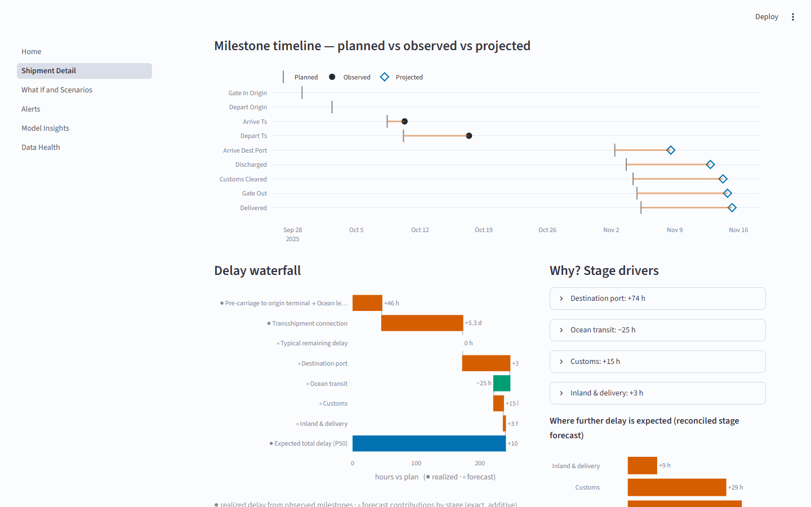
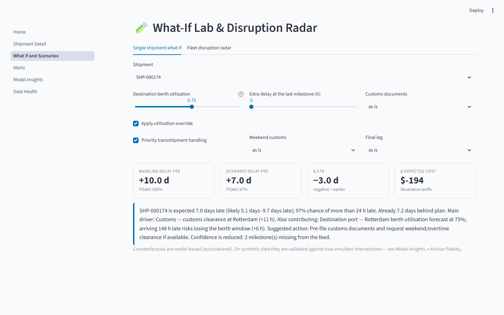
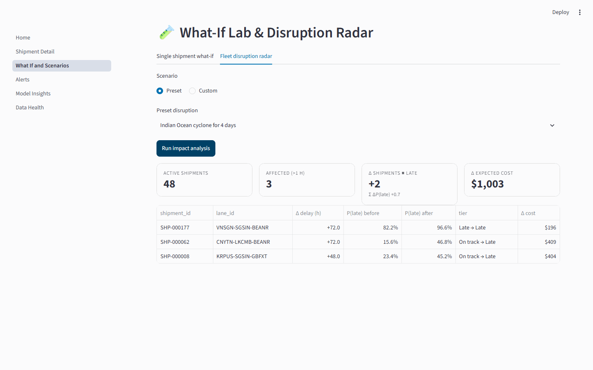
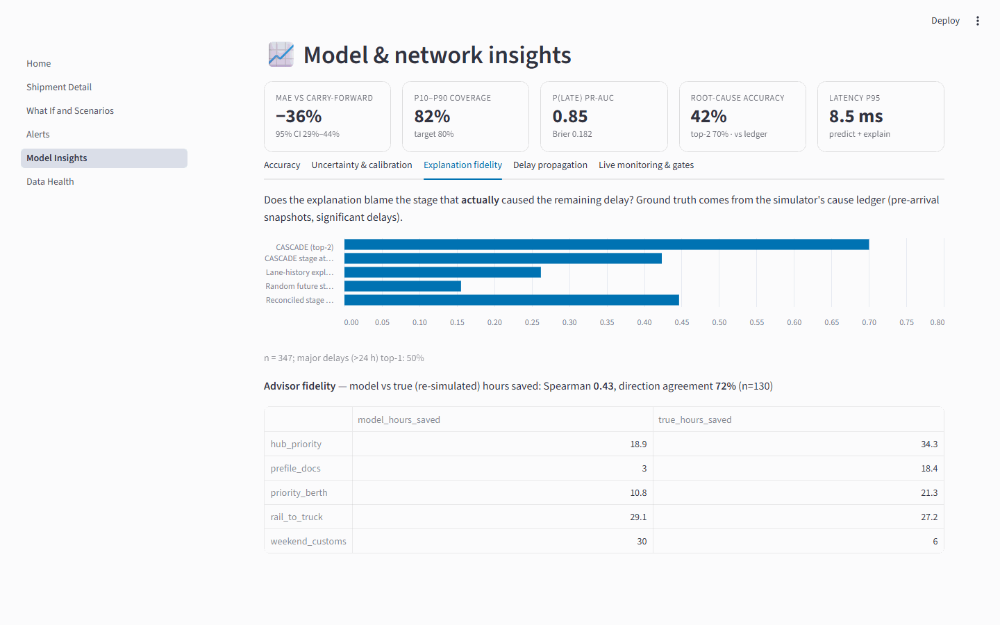
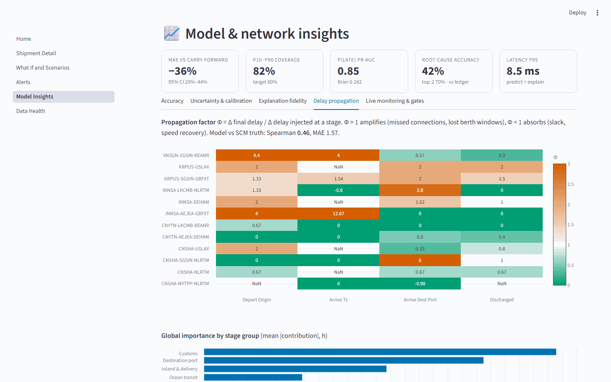

# CASCADE: Stage-Aware Shipment ETA & Delay Propagation

**CASCADE** (Causal-Aware Stage-Chained Arrival & Delay Estimator) predicts when a container shipment will really arrive, how likely it is to be late, and **which stage of the journey is causing the delay**. It then turns that into decisions: a stable promise date, alerts, cost-of-delay and ranked interventions. It is trained and tested on a structural causal simulator that records the true cause of every hour of delay. Because of that ledger, the explanations are **scored against ground truth**, not just shown.

> Technical report (3 pages): [`report/CASCADE_Technical_Report.pdf`](report/CASCADE_Technical_Report.pdf) · Docs index: [`docs/`](docs/README.md) · As-built deviations: [`docs/AsBuilt.md`](docs/AsBuilt.md)



## Key results

<!-- RESULTS:START -->
| Metric (out-of-time test, 62 shipments / 726 snapshots) | Seed 42 | 5-seed mean ± sd |
|---|---|---|
| ETA error (MAE, final delay) | 24.5 h vs 38.4 h carry-forward | 25.8 h ± 3.9 h |
| MAE improvement vs carry-forward (B1) | **36%** (95% CI 29%–44%) | 28% ± 5% |
| MAE improvement vs propagation prior (B2) | 30% | 22% ± 6% |
| P10–P90 interval coverage (target 80%) | 82% | 80% ± 3% |
| P(late > 24 h): Brier · PR-AUC | 0.182 · 0.85 | 0.163 ± 0.019 · 0.87 ± 0.02 |
| Root-cause stage vs cause ledger: top-1 · top-2 | 42% · 70% | 47% ± 4% · 68% ± 3% |
| Root-cause lift vs lane-history explainer | +16 pp | +9 pp ± 7 pp |
| Propagation factor vs re-simulated truth (Spearman) | 0.46 | 0.35 ± 0.06 |
| Waterfall additivity violations | 0 / 261 |  |
| Latency p95 (predict + explain) | 8.5 ms | 6.1 ms ± 2.7 ms |

<sub>Generated by `report/build_report.py` from `reports/metrics.json` and `reports/seeds.json` (model v1.0.0). Do not edit by hand.</sub>
<!-- RESULTS:END -->

**How to read this.** Most of the accuracy comes from a mechanistic *operator-rulebook* projection of the remaining stages. On temporal validation, the learned median correction did **not** beat that projection, so the pipeline automatically set its weight to zero. The ML adds value elsewhere: calibrated P(late), conformal P10–P90 ranges and stage-level forecasts. Seed 42 is the most favourable of five seeds for MAE, so the 5-seed column is the fairer summary. The weakest claim is root-cause attribution: it beats a lane-history explainer on average, but the margin depends on the seed.

## Quick start

A trained model bundle (`artifacts/v1.0.0`) is committed, so you can run the API and UI without training anything.

```bash
uv venv --python 3.12 && uv pip install -e ".[ui,dev]"   # 1. install, then activate: source .venv/bin/activate (Windows: .venv\Scripts\activate)
cascade serve                                            # 2. API on http://127.0.0.1:8000/docs
streamlit run app/Home.py                                # 3. control tower on http://localhost:8501 (second terminal)
```

To rebuild everything from scratch (simulate → train → evaluate → gate → publish, about 1 minute), run `cascade all --force`. This overwrites `data/`, `reports/` and `artifacts/v1.0.0`. `cascade seeds` reruns the 5-seed stability study.

**Docker alternative** (API + UI, healthchecked, API runs as a non-root user):

```bash
docker compose -f docker/compose.yaml up --build
# API: http://localhost:8000/docs   UI: http://localhost:8501
# Ports already taken?  CASCADE_API_PORT=8200 CASCADE_UI_PORT=8701 docker compose -f docker/compose.yaml up --build
```

## How ETA and delay are defined

A shipment moves through a fixed **stage graph**: gate-in → origin departure → (hub arrival → hub departure) → destination arrival → discharge → customs release → gate-out → delivery. Direct lanes skip the hub. All quantities are in hours, and positive means late.

| Quantity | Definition |
|---|---|
| `delay(e_k)` | actual(e_k) − planned(e_k) for milestone e_k |
| `Δ_k` | delay(e_k) − delay(e_{k−1}): the **stage increment** (positive adds delay, negative absorbs it) |
| `D` | delay(DELIVERED) = Σ Δ_k: the total delay |
| `ETA_q(t)` | planned delivery + observed delay so far + predicted **remaining** delay R̂_q(t), for q ∈ {P10, P50, P90} |
| `late` | D > 24 h. P(late) is returned with every ETA |

Predictions are **as-of nowcasts**: at every checkpoint (booked, after each milestone) the model sees only what was known at that moment. That includes *forecasts*, not realised values, of future congestion and weather.

## Architecture



More detail: [`docs/Architecture.md`](docs/Architecture.md). For what changed during the build (CSV/NPZ instead of Parquet, LightGBM `pred_contrib` instead of `shap`, and so on), see [`docs/AsBuilt.md`](docs/AsBuilt.md).

## What's different about it

1. **A cause ledger as ground truth.** The simulator models real logistics mechanics: speed recovery, missed transshipment connections that wait for the *next sailing*, a Kingman berth queue that grows with lateness, customs calendars, rail cut-offs and receiving windows. It tags every hour of delay with its true cause and can re-simulate counterfactuals.
2. **Explanations are measured, not just shown.** Root-cause accuracy, the propagation factor Φ = Δ final delay / Δ injected delay, and advisor "hours saved" are each compared with the simulator's re-simulated truth.
3. **Operator rulebook ≠ simulator.** The physics projection of the remaining stages uses coefficients that are deliberately different from the simulator's, so the model cannot "know the simulator". The ML learns corrections and uncertainty on top, and a temporal-validation step decides how much to trust each part.
4. **A decision layer, not just a number.** It produces a promise ETA with hysteresis, alerts, cost-of-delay (demurrage, detention, missed appointments, inventory carry), a ranked intervention advisor, a fleet disruption radar and a prediction ledger.
5. **Production habits.** It answers in milliseconds, has a fallback chain (model → lane propagation prior → carry-forward), uses versioned bundles with quality gates, and has an import-linter layer contract, CI on Linux and Windows, and Docker.

## API example

```bash
# 1. Get a ready-made request body for a shipment, as of the world's "now"
curl -s http://127.0.0.1:8000/v1/shipments/SHP-000174/payload > payload.json

# 2. Predict ETA, P(late), stage forecasts, waterfall and narrative
curl -s -X POST http://127.0.0.1:8000/v1/predict -H "Content-Type: application/json" -d @payload.json
```

Shortened response:

```json
{
  "shipment_id": "SHP-000174",
  "checkpoint": "AFTER_DEPART_TS",
  "eta": {"p10": "…", "p50": "…", "p90": "…"},
  "delay_hours": {"observed": "…", "p10": "…", "p50": "…", "p90": "…"},
  "p_late": 0.9999,
  "risk_tier": "LATE",
  "root_cause_group": "PORT",
  "narrative": "SHP-000174 is expected 10.0 days late (likely 6.9–12.5 days late) … Main driver: Destination port: Rotterdam berth utilisation forecast at 93% …",
  "waterfall": ["…"], "stage_forecast_hours": {"…": "…"}, "cost_usd": {"…": "…"}, "promise": {"…": "…"}
}
```

Other endpoints: `/v1/predict/batch`, `/v1/explain`, `/v1/whatif`, `/v1/advise`, `/v1/fleet`, `/v1/alerts`, `/v1/scenarios/impact`, `/v1/insights`, `/v1/monitoring/accuracy`, `/v1/data-health`, `/health`, `/ready`. Full OpenAPI docs are at `/docs`.

## Screenshots

| | |
|---|---|
|  **Shipment detail:** ETA range, P(late), promise date, cost and a plain-language narrative, with time-travel across checkpoints |  **Delay waterfall:** realised delay plus exact, additive forecast contributions by stage |
|  **What-if lab:** berth override + priority transshipment → −3.0 days |  **Disruption radar:** a 4-day Indian Ocean cyclone flips 2 shipments to late |
|  **Explanation fidelity** against the cause ledger, and advisor fidelity against re-simulated interventions |  **Delay propagation:** Φ by lane and stage (amplifies > 1, absorbs < 1) |

More in [`docs/screenshots/`](docs/screenshots/): alerts, accuracy, data health and the network map.

## Repository map

```
src/cascade/
  domain/     stage graph, delay math, port network, calendars
  sim/        structural causal simulator, cause ledger, counterfactual re-simulation
  data/       validation, out-of-time and voyage-grouped splits
  features/   as-of snapshot builder, operator-rulebook projection, feature registry, OOF priors
  models/     baselines B0–B2, residual quantile LightGBM, late classifier, conformal, stage models, bundles
  explain/    stage contributions, waterfall, narratives for ops / customer / analyst
  eval/       accuracy + bootstrap CIs, calibration, fidelity vs truth, robustness, ablations, figures
  decision/   engine, promise ETA, alerts, cost-of-delay, advisor, scenarios, SQLite prediction ledger
  serving/    FastAPI app and schemas
  cli.py      cascade generate-data | all | seeds | serve
app/          Streamlit control tower (6 pages)
configs/      sim.yaml, train.yaml, costs.yaml
artifacts/    published model bundle v1.0.0 (committed, so the API runs without training)
reports/      metrics.json, seeds.json, figures/
report/       technical report builder → CASCADE_Technical_Report.pdf
docs/         PRD, architecture, design, as-built notes, model card, demo script
docker/       Dockerfile.api, Dockerfile.ui, compose.yaml
tests/        unit, property (leakage, invariants), API contract, perf
```

## Testing and quality

```bash
pytest -q -m "not perf"     # unit, property-based (no leakage, invariants) and API contract tests
pytest -q -m perf           # latency budget
ruff check src tests app && ruff format --check src tests app
mypy && lint-imports        # types + layered-architecture contract
```

CI ([`.github/workflows/ci.yml`](.github/workflows/ci.yml)) runs lint and tests on Ubuntu and Windows. It also does a small end-to-end pipeline run (`cascade all --n 120 --fast`), boots the API on the fresh bundle and makes a real prediction. Perf tests run in a separate job. Pre-commit hooks are in [`.pre-commit-config.yaml`](.pre-commit-config.yaml).

`python report/build_report.py` rebuilds the report PDF and refreshes the results table above from `reports/metrics.json` and `reports/seeds.json`. No number in the report or this table is typed by hand.

## Limitations

- **Synthetic data.** The mechanics are realistic, but the gap between this simulator and real data has not been measured. The next step is an AIS/EDI adapter that maps real milestones onto the stage graph.
- **Counterfactuals are associational** at serving time. They are checked against true simulator interventions offline (advisor fidelity), but not guaranteed causal on real data.
- **Small test set.** The out-of-time test covers the Q4 peak, a deliberate seasonal shift, so the confidence intervals are wide. Results vary across seeds (see the table above).
- **Root-cause forecasting is inherently noisy.** Which *future* stage will dominate is hard to call, so top-2 accuracy is the more useful number.
- **Roadmap:** survival/AFT models for in-flight censoring, GNN-style port-network features for congestion spill-over, and drift monitoring on the prediction ledger with automatic conformal recalibration.

## Documentation

| Doc | What it covers |
|---|---|
| [Technical report (PDF)](report/CASCADE_Technical_Report.pdf) | Approach, assumptions, results (2–3 pages) |
| [docs/PRD.md](docs/PRD.md) | Problem, goals, requirements, success metrics |
| [docs/Architecture.md](docs/Architecture.md) | Components, data flow, latency budget, degradation chain, ADRs |
| [docs/Design.md](docs/Design.md) | Simulator mechanics, features, models, explanations, API contracts |
| [docs/AsBuilt.md](docs/AsBuilt.md) | Every deviation from the plan, and why |
| [docs/ModelCard.md](docs/ModelCard.md) | Auto-generated model card |
| [docs/DemoScript.md](docs/DemoScript.md) | 5-minute demo walkthrough |
