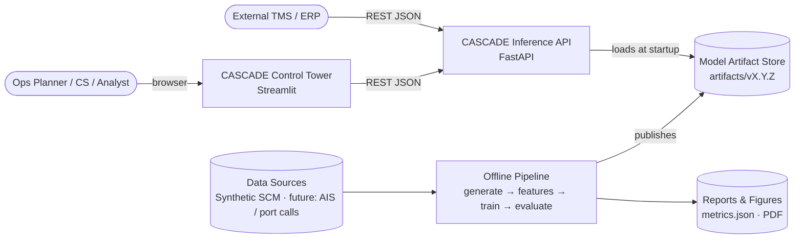
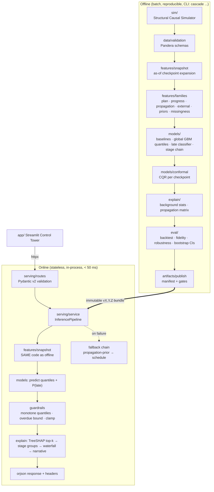
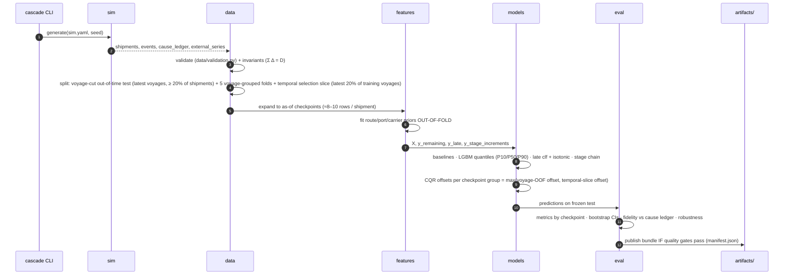
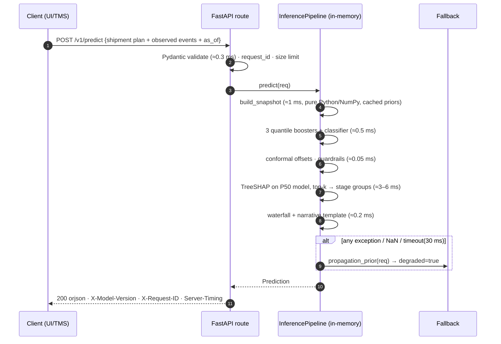
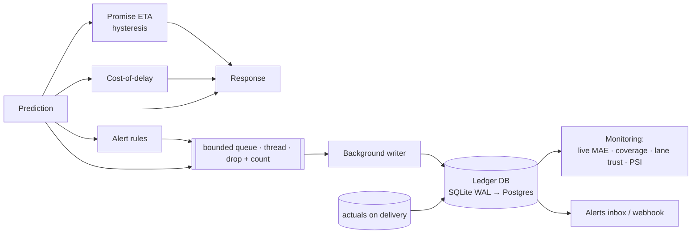
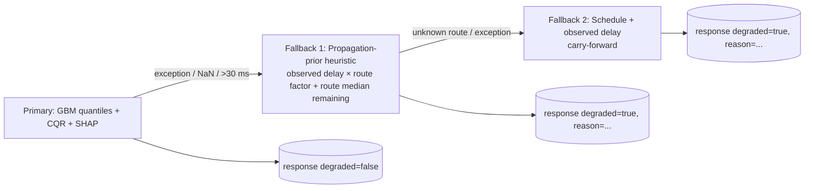
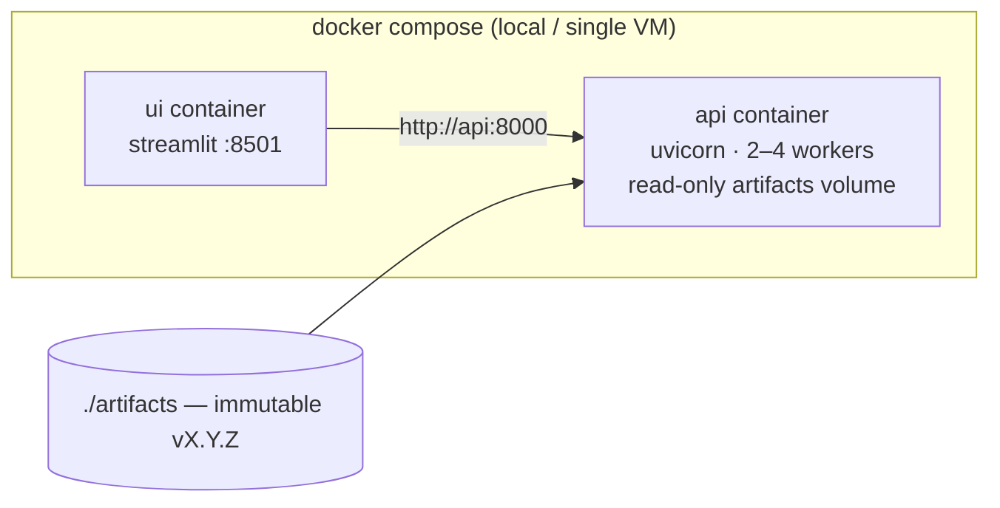

# Architecture — CASCADE

> **As-built note:** implementation details that changed during the build are recorded in [`AsBuilt.md`](AsBuilt.md); where this page and the code disagree, AsBuilt.md is authoritative.
>
> **Review reconciliation (2026-10-13):** an external review was verified claim by claim against the code in [`ReviewVerification.md`](ReviewVerification.md); statements that described the *plan* rather than the build were corrected in place (marked *as built*). Follow-up work is in [`ImprovementPlan.md`](ImprovementPlan.md).

> How the system is structured, how data flows, why it is fast and reliable, and the key decisions (ADRs).
> Detailed algorithms and schemas live in [`Design.md`](Design.md). Tooling lives in [`TechStack.md`](TechStack.md).

---

## 1. Architectural Drivers

| Driver | Consequence for the architecture |
|---|---|
| **Stage relationships matter more than raw accuracy** | One canonical *stage graph* in `domain/` drives the simulator, features, models, explanations and UI |
| **Small data (≈300 shipments)** | Tabular gradient boosting + strong priors + monotone constraints; no deep learning |
| **Explanations are a hard requirement** | Explanations are first-class outputs of the inference pipeline, not a notebook add-on |
| **Low latency (p95 < 50 ms)** | Stateless in-process inference, everything precomputed at train time, no network hops on the hot path |
| **Reliability** | Validation at boundaries, a deterministic degradation chain, immutable versioned artifacts |
| **Many contributors, 3 days** | Thin, stable interfaces between 6 modules so workstreams run in parallel |

---

## 2. System Context (C4 Level 1)

---

## 3. Container / Module View (C4 Level 2)

### Module responsibilities and owners

| Module | Responsibility | Public interface (frozen on Day 0) | Workstream |
|---|---|---|---|
| `domain/` | Stage graph, event enums, ETA/delay math, Pydantic domain models | `StageGraph`, `Shipment`, `Event`, `compute_increments()` | Shared (ML lead approves changes) |
| `sim/` | Port network, mechanics, external factors, missingness, cause ledger | `generate(config, seed) -> SimOutput` | A — Data |
| `data/` | IO, Pandera validation, splits (out-of-time + grouped CV) | `load()`, `validate()`, `make_splits()` | A — Data |
| `features/` | As-of snapshots and feature families; **shared by offline and online** | `build_snapshot(shipment, as_of) -> FeatureRow`, `FEATURE_REGISTRY` | B — ML |
| `models/` | Baselines, GBMs, conformal, reconciliation, artifact IO | `Predictor.predict(X) -> Prediction` | B — ML |
| `explain/` | Stage-grouped SHAP, waterfall, counterfactuals, propagation matrix, narrative | `explain(row, pred, k) -> Explanation` | B — ML |
| `eval/` | Metrics, backtest, attribution fidelity, robustness, figures | `evaluate(run) -> MetricsReport` | B — ML / D — Report |
| `decision/` | Promise ETA, alerts, cost-of-delay, intervention advisor, scenarios, prediction ledger | Pure functions over `Prediction` + `LedgerRepository` | C — Platform (+ B for advisor) |
| `serving/` | FastAPI app, schemas, service, fallback, middleware | OpenAPI `v1` | C — Platform |
| `app/` | Streamlit control tower | Consumes OpenAPI `v1` only | D — UX |

**Dependency rule (enforced by `import-linter` in CI):**
`domain ← sim, data ← features ← models ← explain ← decision (incl. engine) ← eval | serving ← cli`; `app` talks HTTP only.
Nothing imports from `serving` or `app`. `app` never imports `cascade.models` (UI talks to API only), so the UI can be swapped for React without touching ML code.

---

## 4. Data Flow

### 4.1 Offline pipeline

### 4.2 Online request path (hot path)

### 4.3 Decision layer (off the hot path where possible)

- Promise and cost are pure in-memory functions (< 0.2 ms) and go into the response.
- Ledger writes and alert dispatch are **asynchronous**. A slow disk or webhook can never add latency to `/v1/predict`. Queue overflow is shed with a metric.
- `/v1/advise` and `/v1/scenarios/impact` reuse the **vectorised batch path**: N counterfactual variants or N shipments make one model call.

---

## 5. Latency Architecture

**Principle: do expensive work at training time, keep the request path pure in-memory math.**

| Technique | Where | Effect |
|---|---|---|
| Models loaded once at startup, warmed with 50 synthetic requests | `serving/app.py` lifespan | No first-request penalty; `/ready` gates traffic |
| Route/port/carrier priors precomputed into dict lookups | `artifacts/priors.json` | O(1) feature lookups |
| Feature code is vectorised NumPy for batch, scalar fast-path for single | `features/snapshot.py` | Single row ≈ 1 ms |
| Shallow LightGBM (depth ≤ 5, ≤ 300 trees), `num_threads=1` per request | `models/` | Sub-ms inference, no thread contention under concurrency |
| TreeSHAP only on the P50 booster, only top-k on `/predict`; full on `/explain` | `explain/` | Keeps p95 within budget |
| Stage-group mapping precomputed (feature → stage index array) | `explain/stage_groups.py` | Grouping is one `np.add.at` |
| `orjson` responses, Pydantic v2 (Rust core) | `serving/` | Low serialisation overhead |
| Batch endpoint vectorises up to 1,000 rows | `/v1/predict/batch` | Amortises Python overhead |
| `Server-Timing` header breaks down stages | middleware | Latency is observable, not guessed |

### Latency budget (single `/v1/predict`, laptop CPU)

| Step | Budget | Notes |
|---|---|---|
| HTTP + validation | 1.0 ms | uvicorn + Pydantic v2 |
| Snapshot features | 1.5 ms | ≈ 60 features |
| 4 boosters | 1.0 ms | 3 quantiles + classifier |
| Conformal + guardrails | 0.1 ms | |
| TreeSHAP top-k | 6.0 ms | measured in Day-2 benchmark; fallback: precomputed path-dependent SHAP on fewer trees |
| Waterfall + narrative | 0.4 ms | |
| Serialisation | 0.5 ms | orjson |
| **Total target** | **≈ 10 ms p50 / < 50 ms p95** | Verified by `tests/perf/test_latency.py` + `locust` |

---

## 6. Reliability Architecture

### 6.1 Degradation chain (never a silent failure)

### 6.2 Guardrails on every prediction

1. **Quantile non-crossing:** sort `[P10, P50, P90]` after conformal adjustment.
2. **Plausible ETA floor (heuristic):** *as built* `ETA_q ≥ max(as_of, t_last + 0.5 × (planned_DELIVERED − planned_last))`, where `t_last` is the last reported event. The 0.5 is a hard-coded heuristic, not a physical bound; its binding rate and effect on coverage are not yet measured (ImprovementPlan P0-6). The overdue bound applies to the *next* milestone only, inside the projection; slack can absorb delay downstream.
3. **Physical plausibility clamp:** `ETA ≥ as_of` for undelivered shipments; `|D̂| ≤ max_delay_cap` (config, default 30 days) → flag `out_of_distribution`.
4. **Consistency:** waterfall components must sum to P50 (±0.1 h), asserted in tests and logged if violated in production.
5. **Cold start:** unseen route/port/carrier → hierarchical prior back-off (lane → region → global), flag `cold_start=true`.

### 6.3 Boundary validation

- **API:** Pydantic v2 models with field constraints (event ordering, UTC tz-aware timestamps, enum ports, max 50 events, max 1,000 rows per batch). Errors are RFC 7807 `application/problem+json`.
- **Data:** the in-house validator (`data/validation.py`) on every CSV/NPZ read/write; invariant checks (`Σ Δ_k = D`, strictly increasing report times, `DELIVERED` present).
- **Artifacts:** `manifest.json` carries a schema version, feature list hash, a SHA-256 checksum per file, and the training metrics. Serving refuses to load a bundle whose feature hash ≠ code's `FEATURE_REGISTRY` hash. **Training/serving skew is impossible by construction** because both use the same `features/` code.

### 6.4 Quality gates before publishing a model (`cascade publish`)

| Gate | Threshold |
|---|---|
| MAE vs carry-forward baseline | ≥ 15% improvement (hard), 25% (target) |
| P10–P90 coverage (test) | *as built:* 70–90% hard, 80 ± 5 pp target |
| Late-classifier Brier | *as built:* ≤ 0.20 (PRD target ≤ 0.15 is reported separately as met/unmet) |
| Attribution fidelity | *as built:* lift vs lane-history explainer ≥ 10 pp (the original top-1 ≥ 60% is not met: 42%) |
| Waterfall additivity violations | 0 (*a bookkeeping check: real identity tests are ImprovementPlan P0-2*) |
| Latency p95 (perf test) | < 50 ms |
| No metric regresses > 5% vs current published version | relative (*not implemented in v1.0*) |

---

## 7. Deployment View

- **Stateless API** → scale horizontally behind any L7 load balancer; each worker holds its own copy of the model (~few MB).
- **Model rollout:** new bundle → `/v1/model` shows version; blue/green by pointing `CASCADE_MODEL_VERSION` env at the new bundle; instant rollback.
- **Images:** multi-stage, `python:3.12-slim`, non-root user, `HEALTHCHECK` on `/health`.

---

## 8. Scalability Path (what we'd revisit as the system grows)

| Scale | Change |
|---|---|
| 300 → 100k shipments | Polars for feature building; LightGBM still fine; Optuna tuning; nightly retrain job |
| Live milestones (events/s) | Event-driven: Kafka topic `shipment-events` → stateless scorer → ETA store (Redis/Postgres) → push to UI via SSE; same `InferencePipeline` reused |
| Many routes / global network | Port-network features (graph centrality, hub load) → optional GNN embeddings fed as GBM features |
| Censored in-transit training data | Survival / AFT objective (XGBoost `survival:aft`) for remaining time |
| Strict latency (< 5 ms) | Compile trees with `treelite`/`lleaves`, precompute SHAP for top drivers asynchronously |
| Drift | PSI on key features + rolling MAE by checkpoint; alert + retrain trigger |

---

## 9. Architecture Decision Records (ADRs)

### ADR-001 — Synthetic Structural Causal Model as primary data
- **Context:** The brief allows synthetic data and asks for reflection of real-world behavior plus a clear ground-truth definition.
- **Decision:** Build a mechanistic simulator (queues, cut-offs, weekly sailings, calendars) that logs a **cause ledger**.
- **Consequences:** + we can *measure* explanation correctness, + controlled missingness and robustness tests. − Risk of "learning the simulator" → mitigated with noise, latent confounders, out-of-time testing and honest limitations.
- **Alternatives:** Kaggle supply-chain datasets (no stage timestamps, no causes); AIS (too heavy for 3 days).

### ADR-002 — Gradient-boosted trees over deep learning
- **Context:** About 2.4k snapshot rows; interpretability required.
- **Decision:** LightGBM (quantile + binary) with monotone constraints and smoothed priors.
- **Consequences:** + accuracy on small tabular data, exact TreeSHAP, sub-ms inference. − No learned network representations (future: GNN embeddings as features).
- **Alternatives:** GNN / Transformer (data-starved), linear models (miss interactions and thresholds like missed connections), pure rules (no learning of residuals).

### ADR-003 — Predict *remaining* delay from as-of snapshots (nowcasting)
- **Decision:** Target = `D − observed_delay_at_checkpoint`. One model across checkpoints, with `checkpoint_stage` as a feature.
- **Consequences:** + ETA updates naturally as events arrive, + handles missing intermediates, + gives an ETA convergence curve. − Rows of one shipment are correlated → **grouping by voyage** (which keeps each shipment and its co-loaded peers together) is mandatory.

### ADR-004 — Conformalized Quantile Regression for intervals
- **Decision:** LightGBM quantile models + CQR offsets per checkpoint group.
- **Consequences:** + finite-sample marginal coverage under exchangeability, cheap at inference. − Exchangeability is only approximate across time; we report coverage on the out-of-time test to make this visible.

### ADR-005 — Deterministic narrative templates (no LLM on the hot path)
- **Decision:** Narratives come from typed templates filled with SHAP/waterfall facts.
- **Consequences:** + zero hallucination, < 1 ms, testable. − Less fluent. An optional LLM rewrite (P2) must only rephrase the provided facts, and is validated by numeric consistency checks.

### ADR-006 — Monolithic package, modular boundaries
- **Decision:** One Python package with enforced import boundaries; API and UI as separate processes.
- **Consequences:** + fast iteration for a 3-day team, single source of truth for features. − Not microservices; not needed at this scale (revisit at the event-driven stage).

### ADR-007 — Streamlit for the control tower
- **Decision:** Streamlit + Plotly, consuming the public API only.
- **Consequences:** + rich, interactive UI in hours, + forces API dog-fooding. − Less pixel control than React; acceptable for a demo. The swap path is preserved by the HTTP-only boundary.

### ADR-008 — Decision layer as pure functions + async SQLite ledger
- **Context:** Promise ETA, alerts and live accuracy need state across requests, but the predict path must stay stateless and fast.
- **Decision:** Keep decision logic pure (state passed in and out). Persist through a `LedgerRepository` backed by SQLite in WAL mode, written by a background task from a bounded queue.
- **Consequences:** + zero added p95 latency, + replayable evaluation (the same functions run over the test set offline), + a Postgres swap is one class. − SQLite is single-node: fine for the demo, and documented as the first thing to replace when scaling out.

### ADR-009 — Advisor uses a fixed action menu evaluated by counterfactuals
- **Context:** Planners need actions, but free-form optimisation or LLM agents would be unverifiable in 3 days.
- **Decision:** A finite, auditable action list. Each action maps to an explicit feature intervention and is scored with the same model. Its fidelity is validated against true SCM interventions.
- **Consequences:** + explainable, testable, fast. − Model-based counterfactuals are associational; we disclose this in the UI and measure the gap on synthetic data.
