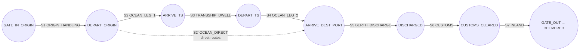
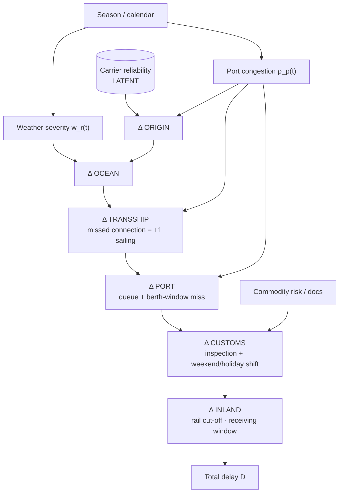

# Design — CASCADE

> **As-built note:** implementation details that changed during the build are recorded in [`AsBuilt.md`](AsBuilt.md); where this page and the code disagree, AsBuilt.md is authoritative.
>
> **Review reconciliation (2026-10-13):** an external review was verified claim by claim against the code in [`ReviewVerification.md`](ReviewVerification.md); statements that described the *plan* rather than the build were corrected in place (marked *as built*). Follow-up work is in [`ImprovementPlan.md`](ImprovementPlan.md).

> Detailed technical and UX design: domain model, simulator mechanics, data schemas, features, models, explanations, evaluation, API contracts and interface design.
> System structure and ADRs: [`Architecture.md`](Architecture.md). Requirements: [`PRD.md`](PRD.md).

---

## 1. Domain Model

### 1.1 Canonical stage graph

One definition in `src/cascade/domain/stages.py` drives everything (simulator, features, explanations, UI).



- **Events** (`EventType` enum): `GATE_IN_ORIGIN, DEPART_ORIGIN, ARRIVE_TS, DEPART_TS, ARRIVE_DEST_PORT, DISCHARGED, CUSTOMS_CLEARED, GATE_OUT, DELIVERED`.
- **Stages** are the edges. Direct routes skip `ARRIVE_TS/DEPART_TS`. This is **structural absence**, encoded as `has_transshipment=0`, *never* as missing data.
- **Stage groups** for explanations: `ORIGIN, OCEAN, TRANSSHIPMENT, PORT, CUSTOMS, INLAND, CONTEXT, DATA_QUALITY`.

### 1.2 Core math (in `domain/delay.py`, property-tested)

```
delay(e_k)    = actual(e_k) − planned(e_k)                # hours, + = late
Δ_k           = delay(e_k) − delay(e_{k−1})               # stage increment (+ adds, − absorbs)
D             = delay(DELIVERED) = Σ_k Δ_k                 # total delay
R(t)          = D − delay_last_observed(t)                 # remaining delay at as-of t (model target)
ETA_q(t)      = planned(DELIVERED) + delay_last_observed(t) + R̂_q(t),  q ∈ {P10,P50,P90}
late          = 1[D > τ],  τ = 24h (config; also report 48h)
lower_bound(t)= max(delay_last_observed, now − planned(next_event))  # NEXT milestone only (unless a reporting gap)
# as built: applied to the projected delay of the next milestone inside the rulebook projection (not an output clamp),
# and skipped when a reporting gap is inferred (overdue > 48-120 h by event, or the milestone after next is also overdue)
ETA_floor(t)  = as_of + 0.5 × planned remaining time                # final ETA guardrail
```

### 1.3 Reference network (synthetic, grounded in real geography)

| Role | Ports (UN/LOCODE) | Notes |
|---|---|---|
| Origins | CNSHA Shanghai, CNYTN Yantian, KRPUS Busan, INNSA Nhava Sheva, VNSGN Ho Chi Minh | CN ports get a Lunar New Year slowdown |
| Hubs | SGSIN Singapore, LKCMB Colombo, AEJEA Jebel Ali, MYTPP Tanjung Pelepas | Transshipment with weekly or twice-weekly connecting services |
| Destinations | NLRTM Rotterdam, DEHAM Hamburg, BEANR Antwerp, GBFXT Felixstowe, USLAX Los Angeles | Different customs regimes and weekend practices |

Around **14 lanes** (≈40% direct, 60% via a hub), **5 carriers**, **3 commodity risk classes**, inland mode ∈ {truck, rail}.
Each port has: `base_utilization`, `berth_capacity`, `base_handling_h`, `customs_base_h`, `inspection_rate`, `customs_works_weekend`, `tz`, `holidays`.

---

## 2. Simulator Design (Structural Causal Model) — `src/cascade/sim/`

### 2.1 Causal graph



### 2.2 Mechanics (each produces ledger entries `(shipment_id, stage, cause, hours)`)

| Stage | Mechanism (real-world behavior) | Formula sketch | Cause tags |
|---|---|---|---|
| **Voyages** | Shipments share vessels, so errors are correlated within a voyage | `voyage_id` groups 1 + Poisson(2) shipments, capped at 6 (seed 42: 300 shipments in 103 voyages) | — |
| **ORIGIN** | Carrier reliability + origin congestion + storms delay departure | `Δ = LogNormal(μ_carrier, σ) + a·max(0, ρ_o − 0.75) + storm` (voyage-shared) | `carrier_late_departure`, `origin_congestion`, `weather` |
| **OCEAN** | Weather slows the vessel; the vessel **recovers** part of the delay by speeding up (absorption) | `Δ = b·w̄·dist_kdays + ε − min(κ·max(delay_in,0), C_max)` with κ≈0.25, C_max≈18 h | `weather`, `speed_recovery` (negative), `noise` |
| **TRANSSHIP** | Cargo must be handled at the hub before the connecting cut-off. If late, it **waits for the next sailing** (+168 h weekly / +84 h bi-weekly). Hub congestion lengthens handling | `ready = arr_delay + h_hub·(1+γ·ρ_hub)`; `miss = ready > buffer`; `Δ = miss·headway + ε` | `missed_connection`, `hub_congestion` |
| **PORT** (berth + discharge) | Queue wait grows non-linearly with utilization (Kingman-like). A late vessel **loses its berth window** and waits longer, which is the congestion × lateness interaction | `W = w0·ρ/(1−ρ)`; `if arr_delay > tol: W ·= (1+λ·ρ)`; `Δ = W − planned_wait + discharge_noise` | `berth_queue`, `berth_window_miss` |
| **CUSTOMS** | Base processing varies by country. Inspection probability rises with commodity risk and incomplete documents. **Calendar shift** if release lands outside office hours or on a weekend/holiday | `p_insp = σ(a + b·risk + c·doc_incomplete)`; `t_ready → next_business_slot(tz)` | `customs_inspection`, `weekend_holiday_closure`, `customs_variance` |
| **INLAND** | Rail departs at fixed times, so a missed cut-off waits for the next train. Trucks need appointments. Consignee **receiving windows** (Mon–Sat 08–18 local) | `Δ = wait_to_next_departure + drive_noise + window_shift` | `missed_rail_cutoff`, `receiving_window`, `road_noise` |

**Cause-ledger allocation policy for interactions** (*as built*, `sim/mechanics.py`). Each interaction is booked **wholly to one tag**; nothing is split proportionally:
- berth congestion × lateness → `berth_window_miss` (the pure congestion wait is `berth_queue`);
- a missed hub connection → `missed_connection_hub_congestion` if uncongested handling would have made the cut-off, otherwise `missed_connection`. Upstream lateness that caused the miss stays on HUB_DWELL, and the incoming delay is cancelled with `slack_absorption`;
- a late arrival landing on a weekend → `weekend_holiday_closure`;
- anything unexplained → `other`.

So "root cause" scores the *stage* where the interaction materialised, not the upstream trigger.

**External series** (daily, per port/region):
- Congestion `ρ_p(t) = clip(base_p + seasonal_p(t) + AR(1) noise, 0.30, 0.97)`. Seasonality covers the Q4 peak and the Lunar New Year backlog at CN ports, with a spill-over to hubs about 2 weeks later.
- Weather `w_r(t) ∈ [0,1]` with Poisson storm episodes; the Indian Ocean monsoon (Jun–Sep) raises the rate.
- **As-of forecasts:** for future dates the model sees `ρ̃ = ρ + N(0, σ_h²)`, where σ grows with the horizon h. Past dates are realized. This mimics real forecast quality and prevents leakage.

### 2.3 Missingness (three distinct kinds, each handled differently)

| Kind | Generator | Model handling |
|---|---|---|
| **Structural** (no TS on direct routes) | By lane | `has_transshipment=0`; TS features = sentinel, not NaN |
| **MCAR** reporting gaps | Each intermediate event dropped w.p. 0.06 | NaN + `is_observed_*` flags. *As built: not interpolated; the snapshot uses the last observed event and records gaps as `n_missing_past` / `completeness_ratio`* |
| **MNAR** | Low-EDI carriers drop events w.p. 0.25; `DISCHARGED` drops more when ρ > 0.85 | Missingness flags carry signal (`carrier_edi_tier`, `n_missing_past`) |

`DELIVERED` is always observed (needed as ground truth). *As built:* report timestamps get ±0.75 h uniform jitter around the occurrence time, and that one number is used both as the event time and as the time the system learned it. A report can therefore precede its event by up to 0.75 h, and reports are never late. ImprovementPlan P0-5 separates `actual_h` (occurrence) from `available_h = actual_h + latency` (latency ≥ 0, by EDI tier).

### 2.4 Ground truth and the cause ledger

- `cause_ledger`: one row per `(shipment_id, stage, cause, hours)`. **Invariant:** for each shipment and stage, `Σ hours = Δ_k`, and over all rows `Σ = D` (asserted, tolerance 1 min).
- **True root cause** = the stage (and dominant cause tag) with the largest positive Δ_k, if it is > 6 h. Otherwise `NONE`.
- **True propagation factor** (unique to this design): re-run the SCM with the *same random state* after injecting +δ hours at stage i, giving `Φ_true(i) = ΔD/δ`. This is the ground truth for the propagation-matrix evaluation.

### 2.5 Configuration (`configs/sim.yaml`)

```yaml
seed: 42
n_shipments: 300
start_date: 2025-01-06
end_date: 2025-12-22
late_threshold_h: 24
missingness: {mcar_rate: 0.06, low_edi_rate: 0.25, discharge_congestion_rate: 0.15}
mechanics:
  ocean_recovery_kappa: 0.25
  ocean_recovery_cap_h: 18
  berth_window_tolerance_h: 12
  berth_window_penalty_lambda: 0.8
  hub_handling_gamma: 1.2
noise_scale: 1.0          # irreducible noise multiplier (robustness study)
```

---

## 3. Data Schemas (*as built:* CSV/JSON/NPZ, validated by `data/validation.py`)

**`shipments`** — one row per shipment (plan + static attributes)

| Column | Type | Notes |
|---|---|---|
| `shipment_id` | str | `SHP-000123` |
| `voyage_id` | str | Shared vessel voyage (used for grouped CV) |
| `lane_id`, `origin`, `hub`, `destination` | category | `hub` null for direct (structural) |
| `carrier`, `carrier_edi_tier` | category | |
| `commodity_risk` | int8 {0,1,2} | |
| `docs_complete` | bool | |
| `inland_mode` | category {truck, rail} | |
| `planned_<event>` | timestamp[UTC] | One per event in the stage graph |
| `actual_delivered` | timestamp[UTC] | Ground truth |
| `total_delay_h`, `is_late` | float32, bool | Derived, validated |

**`events`** (long) — *as built:* `shipment_id, event, seq, planned_h, actual_h, reported (bool), reported_h (NaN if missing)`; times are float hours since 2025-01-01 UTC
**`cause_ledger`** — `shipment_id, stage, group, cause, hours`
**`external_daily`** — `date, port_or_region, congestion, weather`

---

## 4. As-of Snapshot Design (the anti-leakage core)

Each shipment expands into **checkpoints**:

1. `BOOKED`: as_of = planned gate-in − 72 h (nothing observed).
2. After each **reported** event k: as_of = reported(e_k) + 1 min (*as built: `reported_h` is the occurrence time ± 0.75 h jitter; there is no separate availability time yet (P0-5)*).
3. One **mid-stage** sample per stage: as_of ~ U(actual(e_k), actual(e_{k+1})). This teaches "overdue" behavior (a vessel is still at sea past its planned arrival). *As built: one per stage ending at ARRIVE_TS, DEPART_TS, ARRIVE_DEST_PORT, DISCHARGED or CUSTOMS_CLEARED when the stage lasts > 2 h, placed using true actual times.*

That is ≈ 8–12 rows per shipment, so ≈ 3,000 rows for 300 shipments.

**Leakage contract** (enforced by `tests/property/test_no_leakage.py` using Hypothesis):
> For any checkpoint *t*, perturbing any `actual_ts > t`, any external value dated > t (other than through its noisy forecast), or the cause ledger must leave the feature row **bit-identical**.

`build_snapshot(shipment, events, external, priors, as_of) -> FeatureRow` is the **only** feature entry point, and it is used by training, evaluation and serving alike.

---

## 5. Feature Catalogue (`features/registry.py`)

Every feature declares: `name, family, stage_group, dtype, monotone (−1/0/+1), available_at`.

| Family | Feature | Definition | Stage group | Mono |
|---|---|---|---|---|
| **Plan** | `lane_id`, `origin`, `destination`, `hub`, `carrier` | Categoricals (LightGBM native) | CONTEXT | 0 |
| | `has_transshipment`, `inland_mode`, `commodity_risk`, `docs_complete` | | CONTEXT/CUSTOMS | 0 |
| | `planned_transit_h`, `planned_ocean_h`, `planned_ts_buffer_h`, `planned_customs_h` | From schedule | various | 0 |
| | `dep_week_sin/cos`, `is_peak_season`, `lny_window` | Seasonality | CONTEXT | 0 |
| | `holidays_in_customs_window` | Count of dest holidays in the planned customs window | CUSTOMS | + |
| **Progress** | `checkpoint_stage` | Ordinal 0–8 | CONTEXT | 0 |
| | `current_delay_h` | Delay at the last observed event | stage of that event | + |
| | `delay_velocity_h_per_day` | Change of delay over the last two observed events | OCEAN | 0 |
| | `max_delay_so_far_h`, `frac_plan_elapsed`, `hours_since_last_event` | | CONTEXT | 0 |
| | `overdue_h` | `max(0, as_of − (planned_next + current_delay))` | next stage | + |
| **Propagation** ★ | `ts_buffer_remaining_h` | `buffer − projected_delay_at_hub − expected_hub_handling(ρ̃_hub)` | TRANSSHIPMENT | − |
| | `p_miss_connection_prior` | `σ(−ts_buffer_remaining_h / s)` (analytic, not learned) | TRANSSHIPMENT | + |
| | `projected_arrival_delay_h` | `current_delay + route median remaining ocean Δ` | PORT | + |
| | `expected_queue_wait_h` | `w0·ρ̃/(1−ρ̃)` at the destination | PORT | + |
| | `congestion_x_lateness` | `ρ̃_dest × max(projected_arrival_delay_h, 0)` | PORT | + |
| | `customs_weekend_risk` | Projected customs-ready time falls in a non-working slot (local tz) | CUSTOMS | + |
| | `hours_to_next_rail_departure` | From projected gate-out (rail only) | INLAND | + |
| | `remaining_absorption_h` | Remaining speed-recovery capacity + remaining planned slack | OCEAN | − |
| **External** | `rho_origin`, `rho_hub_fcst`, `rho_dest_fcst`, `weather_fcst`, `storm_flag` | Realized if past, noisy forecast if future | ORIGIN/TRANSSHIP/PORT/OCEAN | + |
| **Priors** (out-of-fold, smoothed) | `lane_mean_delay`, `lane_p90_delay`, `carrier_ontime_90d`, `dest_berth_mean_Δ`, `dest_customs_mean_Δ`, `hub_miss_rate` | `(n·mean + m·global)/(n+m)`, m=20, fit within fold only | matching stage | 0 |
| **Data quality** | `is_observed_<event>`, `n_missing_past`, `completeness_ratio`, `carrier_edi_tier` | | DATA_QUALITY | 0 |

★ = the interaction features the brief asks for. They encode *how* upstream delay meets downstream capacity.

**Imputation rules:** a missing past event with a later observed neighbour gets linear interpolation of the delay (flagged). With no later neighbour, the last observed delay is carried forward and `hours_since_last_event` grows. LightGBM receives NaN for truly unknown numerics.

---

## 6. Models (`src/cascade/models/`)

### 6.1 Baselines (must be beaten, reported on the same split)

| ID | Name | Prediction of D̂ |
|---|---|---|
| B0 | Schedule | `0` (ETA = plan) |
| B1 | Carry-forward | `current_delay_h` |
| B2 | Propagation prior | `φ_{lane,stage}·current_delay + Σ_{future k} median(Δ_k | lane)`, with φ fit by OLS within fold |

### 6.2 Main model — "Prior + Residual Booster"

- **Target:** remaining delay `R = D − current_delay`. *As built:* a residual over the **operator-rulebook projection** of every remaining stage (`features/snapshot.py`, coefficients deliberately different from the simulator's). The learned median correction is blended with strength λ ∈ {0, .25, .5, .75, 1}, chosen on the latest 20% of training voyages. **λ = 0 on seed 42**, so the P50 is the rulebook plus the ETA floor; q10/q90 keep their learned spread around it.
- **Quantile boosters:** three LightGBM models, `objective=quantile`, α ∈ {0.1, 0.5, 0.9}.
- **Hyperparameters (small-data defaults):** `num_leaves=15, max_depth=5, learning_rate=0.05, n_estimators≤300 (early stopping on grouped CV), min_data_in_leaf=20, feature_fraction=0.8, bagging_fraction=0.8, lambda_l2=1.0, no monotone constraints on the quantile models (*as built:* LightGBM 4.7 raises `Cannot use monotone_constraints in quantile objective`); the late classifier is constrained, but LightGBM silently downgrades method `advanced` to `basic` because `feature_fraction < 1`, and the rulebook `proj_inc_*` features are left unconstrained, num_threads=1 at inference`. Optuna not used (AsBuilt).
- **Late classifier:** LightGBM binary on `1[D>τ]` + **isotonic calibration** on out-of-fold scores. A consistency monitor compares it with the quantile-implied P(late) (interpolating the predictive CDF).

### 6.3 Conformal calibration (CQR)

1. *As built:* there is no separate calibration set. Offsets are computed twice: on 5-fold voyage-grouped OOF predictions over all training rows, and on the temporal slice (latest 20% of training voyages, models fit on the earlier 80%). Per group, the larger one is used (drift-aware CQR).
2. Score `E_i = max(q̂_10 − y_i, y_i − q̂_90)`.
3. Per **checkpoint group** g ∈ {pre-departure, at-sea, at-port, post-customs}: `Q_g = quantile(E, ⌈(n_g+1)(1−α)⌉/n_g)`.
4. At inference: `[q̂_10 − Q_g, q̂_90 + Q_g]`, then sort, then apply the heuristic ETA floor. Coverage is evaluated on this final output. It is **empirical held-out coverage**, not a guarantee: exchangeability fails under the Q4 shift and voyage correlation.

### 6.4 Stage-chain forecaster + reconciliation (P1)

- One LightGBM (L1) per stage k predicting Δ_k from the snapshot (direct strategy, no recursion → no error compounding). It is trained only on rows where stage k is still in the future.
- **Reconciliation:** `Δ̂*_k = Δ̂_k + w_k·(R̂_P50 − Σ_j Δ̂_j)`, with `w_k ∝ Var(residual_k)` estimated out-of-fold. The timeline then sums exactly to the global P50, and the uncertain stages absorb the correction.

### 6.5 Artifact bundle (`artifacts/v{semver}/`)

```
manifest.json        # version, created_at, git_sha, data_hash, config_hash, feature_hash, metrics, gates
models/q10.txt q50.txt q90.txt late_clf.txt stage_*.txt   # LightGBM native text
calibration.json     # CQR offsets per group, isotonic thresholds
priors.json          # lane/port/carrier priors + global fallbacks
stage_groups.json    # feature → stage-group index map
propagation.json     # Φ matrix per lane/stage (for UI)
```

---

## 7. Explainability Design (`src/cascade/explain/`)

### 7.1 Three lenses, one consistent story

| Lens | Question answered | Method |
|---|---|---|
| **Realized** | "Where has delay already happened?" | Observed Δ_k for completed stages (facts, not model output) |
| **Forecast drivers** | "Why do we expect *more* delay?" | *As built:* rulebook stage projection (`proj_inc_*`) **+ λ × TreeSHAP** of the residual P50 booster, summed by stage group. **At λ = 0 the drivers are the rulebook alone**, and the UI/report must say so (ImprovementPlan P0-1). The reconciled stage-forecast models are a learned alternative (top-1 44.7% vs 42.4%) |
| **Counterfactual** | "What would change it?" | Re-predict with an intervention (congestion → lane median, upstream delay → 0, weather → calm) |

### 7.2 Delay waterfall algorithm

```
# as built (explain/explainer.py:237-246)
for each observed milestone up to last_event:  bars += [(label, Δ_obs, kind="realized")]   # facts; sum = current_delay
bars += [("Typical remaining delay", λ · q50_bias, kind="baseline")]   # 0.0 h when λ = 0 (misleading label -> P0-1)
for g in stage_groups with |sum_g| >= 0.05:  bars += [(g, proj_inc_g + λ·SHAP_g, kind="forecast")]  # rulebook (+ learned)
bars += [("Consistency guardrail", P50 − Σ previous, kind="guardrail")]  # ETA floor + quantile sort, defined as the remainder
bars += [("Expected total delay (P50)", P50, kind="total")]
# NOTE: because the guardrail row is the remainder, "parts sum to P50" cannot fail. The real identities
# (realised + rulebook + learned = raw P50; raw P50 + floor + ordering = final P50) are ImprovementPlan P0-2
```

The UI draws realized bars solid and forecast bars hatched, with the P10–P90 bracket on the final bar.

### 7.3 Narrative templates (deterministic, `explain/narrative.py`)

```
HEADLINE  : "{id} is expected {late_word} by {p50} (likely {p10}–{p90}); {p_late:.0%} chance of >{tau}h late."
ROOT      : "Main driver: {stage_label} — {cause_phrase} ({+x}h)."
SECONDARY : "Also contributing: {stage2} ({+y}h)."
CONFIDENCE: "Confidence is {high|medium|low} because {reason}."   # interval width / missing data / cold start
ACTION    : "{action_hint}"   # lookup: missed_connection → "Check next sailing from {hub}; consider re-booking."
```

`cause_phrase` comes from the top features in the group, e.g. `ts_buffer_remaining_h = −7` → "arrived after the connection cut-off at Singapore (buffer exhausted by 7 h)".

### 7.4 Delay Propagation Matrix

- **Model view:** `Φ̂(lane, i) = mean_x[(f(x | delay_i + δ) − f(x)) / δ] + 1`, with δ = 6 h (*as built: δ = 12 h, a single size, applied after reported DEPART_ORIGIN / ARRIVE_TS / ARRIVE_DEST_PORT / DISCHARGED; no conditioning on connection buffer and no per-cell counts; see ImprovementPlan P1-6*), over test snapshots right after stage i. The `+1` accounts for carrying the observed delay itself.
- **Truth view:** `Φ_true` from SCM re-simulation (§2.4).
- Reported as a heatmap. **Propagation fidelity** = Spearman ρ(Φ̂, Φ_true) and MAE.
- Expected pattern (sanity check): Φ < 1 on long ocean legs (recovery absorbs), Φ ≫ 1 near hub cut-offs (step jump), Φ > 1 when berth congestion is high.

---

## 8. Evaluation Design (`src/cascade/eval/`)

| Aspect | Protocol |
|---|---|
| **Splits** | *As built:* out-of-time test = the latest **voyages** by planned departure until ≥ 20% of shipments (seed 42: 62 shipments / 20 voyages / 726 snapshots; train 238 / 83 / 2,671). Five folds built by greedy voyage→fold assignment (shared vessels never straddle folds). Temporal selection slice = latest 20% of training voyages. The split is by `shipment_id` after snapshot expansion, with no shipment in two splits. Not yet done: an embargo on training labels realised after the first test departure (P1-2) |
| **Point accuracy** | MAE, RMSE, median AE, P90 AE of D̂ in hours, **overall and per checkpoint** → *ETA convergence curve* |
| **Classification** | PR-AUC, ROC-AUC, Brier, F1 at best threshold, reliability diagram (τ = 24 h and 48 h) |
| **Intervals** | PICP (target 80%), mean interval width, per checkpoint group, interval score |
| **Explanations** | Attribution fidelity top-1 / top-2 accuracy vs ledger (future stages, pre-arrival checkpoints); compared with *route-prior* and *random* explainers; cause-tag confusion matrix. *As built: label = argmax of net future-stage ledger increments (> 6 h) at checkpoints ≤ 4. 25% of scored snapshots have a top-1/top-2 margin < 6 h; ambiguity and per-checkpoint results are not yet reported (P1-1)* |
| **Propagation** | Spearman ρ and MAE between Φ̂ and Φ_true |
| **Uncertainty of metrics** | Shipment-level bootstrap (1,000×) → 95% CIs; 5 simulator seeds → mean ± sd. *As built: the bootstrap unit is the shipment; with only 20 test voyages, a voyage-cluster bootstrap is needed (P1-1)* |
| **Ablations** | −propagation features, −priors, −missingness flags, direct vs residual target, ±monotone constraints |
| **Robustness** | Extra event dropout of 10/30/50% at test time → MAE degradation curve; `noise_scale` sweep |
| **Learning curve** | n ∈ {100, 200, 300, 1k, 5k} shipments |
| **Slices** | Direct vs transshipment, lane, carrier EDI tier, peak vs off-peak |

Outputs: `reports/metrics.json` (machine-readable, used by CI gates) + `reports/figures/*.png` (used by the PDF report and the UI).

---

## 9. API Design (`/v1`, FastAPI, OpenAPI auto-docs at `/docs`)

| Method | Path | Purpose | Target p95 |
|---|---|---|---|
| POST | `/v1/predict` | ETA + quantiles + P(late) + top-k drivers + compact waterfall + narrative | < 50 ms |
| POST | `/v1/predict/batch` | Up to 1,000 shipments, drivers optional | < 1 s / 1k |
| POST | `/v1/explain` | Full SHAP by feature & stage, full waterfall, stage timeline | < 80 ms |
| POST | `/v1/whatif` | Prediction under interventions + Δ vs baseline | < 100 ms |
| GET | `/v1/shipments/{id}` | Demo convenience: load a stored shipment snapshot | < 20 ms |
| GET | `/v1/insights/propagation` | Propagation matrix for UI | cached |
| GET | `/v1/model` | Manifest: version, metrics, feature hash | cached |
| POST | `/v1/advise` | Ranked interventions with hours & $ saved (§11.4) | < 150 ms |
| POST | `/v1/scenarios/impact` | Fleet-level disruption impact (§11.5) | < 1 s / 1k |
| GET | `/v1/alerts?status=open` | Alert inbox (§11.2) | < 20 ms |
| GET | `/v1/monitoring/accuracy` | Rolling live accuracy, coverage, lane trust (§11.6) | < 50 ms |
| GET | `/health`, `/ready` | Liveness / readiness (model loaded and warmed up) | < 5 ms |

`/v1/predict` additionally returns `promise_eta`, `cost_usd {p10,p50,p90}` and `lane_trust`, and accepts `?audience=ops|customer|analyst`.

### 9.1 `POST /v1/predict` — request

```json
{
  "shipment": {
    "shipment_id": "SHP-000123",
    "lane_id": "CNSHA-SGSIN-NLRTM",
    "carrier": "C3",
    "commodity_risk": 1,
    "docs_complete": true,
    "inland_mode": "rail",
    "planned": {
      "GATE_IN_ORIGIN": "2025-03-01T08:00:00Z",
      "DEPART_ORIGIN": "2025-03-03T14:00:00Z",
      "ARRIVE_TS": "2025-03-09T06:00:00Z",
      "DEPART_TS": "2025-03-10T18:00:00Z",
      "ARRIVE_DEST_PORT": "2025-03-30T04:00:00Z",
      "DISCHARGED": "2025-03-31T04:00:00Z",
      "CUSTOMS_CLEARED": "2025-04-01T16:00:00Z",
      "DELIVERED": "2025-04-03T12:00:00Z"
    },
    "observed": {
      "GATE_IN_ORIGIN": "2025-03-01T09:10:00Z",
      "DEPART_ORIGIN": "2025-03-04T09:00:00Z",
      "ARRIVE_TS": "2025-03-10T02:00:00Z"
    }
  },
  "as_of": "2025-03-10T03:00:00Z",
  "options": {"top_k": 5, "include_waterfall": true, "late_threshold_h": 24}
}
```

### 9.2 Response

```json
{
  "shipment_id": "SHP-000123",
  "model_version": "1.2.0",
  "as_of": "2025-03-10T03:00:00Z",
  "checkpoint": "AFTER_ARRIVE_TS",
  "eta": {"p10": "2025-04-09T10:00:00Z", "p50": "2025-04-10T20:00:00Z", "p90": "2025-04-12T06:00:00Z"},
  "delay_hours": {"observed": 20.0, "p10": 166.0, "p50": 200.0, "p90": 234.0},
  "p_late": 0.97,
  "risk_tier": "LATE",
  "drivers": [
    {"stage_group": "TRANSSHIPMENT", "contribution_h": 151.3, "top_feature": "ts_buffer_remaining_h", "value": -7.0,
     "phrase": "arrived after the connection cut-off at Singapore (buffer exhausted by 7 h)"},
    {"stage_group": "PORT", "contribution_h": 14.2, "top_feature": "rho_dest_fcst", "value": 0.91,
     "phrase": "Rotterdam expected at 91% utilization"}
  ],
  "waterfall": [{"label": "Origin handling", "hours": 1.2, "kind": "realized"}, "..."],
  "narrative": "SHP-000123 is expected ~8.3 days late (likely 6.9–9.8 days); 97% chance of >24h late. Main driver: Transshipment — arrived after the connection cut-off at Singapore (+151 h). ...",
  "flags": {"degraded": false, "cold_start": false, "missing_events": [], "out_of_distribution": false},
  "timing_ms": {"features": 0.9, "inference": 0.6, "explain": 4.1, "total": 6.3}
}
```

### 9.3 Errors (RFC 7807 `application/problem+json`)

| Status | `type` | When |
|---|---|---|
| 422 | `/errors/validation` | Schema violation, naive timestamp, observed event after `as_of`, non-monotone actuals |
| 413 | `/errors/payload-too-large` | Batch > 1,000 or > 50 events |
| 404 | `/errors/not-found` | Unknown `shipment_id` on GET |
| 503 | `/errors/not-ready` | Model not loaded (readiness false) |
| 200 + `degraded=true` | — | Fallback served (never a 500 for valid input) |

---

## 10. UX Design — "CASCADE Control Tower"

### 10.1 Principles

1. **Answer first.** ETA, delay and risk appear first; details are progressive disclosure.
2. **Uncertainty is always visible.** No point estimate without its range.
3. **Blame a stage, not a feature.** Users see "Transshipment at Singapore", not `ts_buffer_remaining_h`. Raw features sit behind "Show details".
4. **Realized vs forecast is visually distinct**: solid vs hatched, past vs future.
5. **Accessible:** Okabe–Ito palette, icons and text alongside colour, WCAG AA contrast, keyboard navigable.
6. **Fast:** every interaction < 1 s; API calls are cached with `st.cache_data` keyed on `(shipment_id, as_of, model_version)`.

### 10.2 Information architecture

```
Control Tower
├── 1. Fleet Overview       — "What needs my attention now?"
├── 2. Shipment Detail      — "Why is this one late, and how sure are we?"   ← hero page
├── 3. What-If Lab          — "What would change the outcome?"
└── 4. Model & Network Insights — "Can I trust it? Where do delays amplify?"
```

### 10.3 Wireframes

**Fleet Overview**
```
┌──────────────────────────────────────────────────────────────────────────────┐
│ CASCADE Control Tower                                  Model v1.2.0 · ● Ready │
├───────────────┬───────────────┬───────────────┬──────────────────────────────┤
│ Active  214   │ Late  31 ▲4   │ At risk  47   │ Median ETA shift  +11 h      │
├───────────────┴───────────────┴───────────────┴──────────────────────────────┤
│ Filters: [Lane ▾] [Carrier ▾] [Risk ▾] [Stage ▾]        Search: [SHP-…    ]  │
├──────────────────────────────────────────────────────────────────────────────┤
│ ID          Lane              ETA (P50)   Range     P(late)  Driver          │
│ SHP-000123  SHA→SIN→RTM       Apr 10      ±1.4 d    97% ■    Transshipment   │
│ SHP-000088  YTN→HAM           Mar 28      ±0.6 d    64% ▲    Port congestion │
│ ...                                                                          │
├──────────────────────────────────────────────────────────────────────────────┤
│ Route map (great-circle arcs coloured by mean P(late), hubs sized by Φ)      │
└──────────────────────────────────────────────────────────────────────────────┘
```

**Shipment Detail (hero page)**
```
┌──────────────────────────────────────────────────────────────────────────────┐
│ SHP-000123 · Shanghai → Singapore → Rotterdam · Carrier C3 · Rail            │
│ ┌──────────────────────────┐  "Expected ~8.3 days late (6.9–9.8). Main      │
│ │ ETA  Apr 10, 20:00 UTC   │   driver: arrived after the connection cut-off │
│ │ P10 Apr 9 · P90 Apr 12   │   at Singapore (+151 h). Action: check next    │
│ │ ■ LATE · 97%             │   sailing; consider re-booking."   [Copy]      │
│ └──────────────────────────┘                                                 │
├──────────────────────────────────────────────────────────────────────────────┤
│ Timeline (Gantt): planned ▭  actual ▬  forecast ░ with P10–P90 whiskers      │
│ ORIGIN ▬▬ │ OCEAN-1 ▬▬▬▬ │ TS ░░░░░░░░ │ OCEAN-2 ░░░░ │ PORT ░ │ CUSTOMS ░ │…  │
│ ◄──── Time-travel: [●───────────────────────] as-of: after ARRIVE_TS ────►   │
├────────────────────────────────────┬─────────────────────────────────────────┤
│ Delay waterfall (realized ▬ / fcst ░)│ Why? (stage drivers → expand features) │
│ Plan ▬+1 ▬+19 ░+151 ░+14 ░+9 = 200h │ TRANSSHIPMENT +151h  ▸ buffer −7h       │
│                                     │ PORT +14h            ▸ ρ_RTM 0.91       │
├────────────────────────────────────┴─────────────────────────────────────────┤
│ Data quality: 1 event missing (DISCHARGED – terminal feed) · Confidence: Med  │
└──────────────────────────────────────────────────────────────────────────────┘
```

**Signature interaction — Time-travel replay:** a slider over checkpoints re-calls `/v1/predict` with an earlier `as_of`. The ETA card, the band and the waterfall animate, so the demo can *show* delay propagating ("at departure we expected +6 h; after Singapore, +200 h because the connection was missed").

**What-If Lab:** sliders for destination congestion, weather and upstream delay, plus toggles for docs-complete and inland mode. It shows the baseline vs scenario ETA band side by side and the ΔP50 in hours.

**Model & Network Insights:** ETA convergence curve (MAE vs checkpoint, model vs baselines), calibration/reliability plot, coverage by checkpoint, propagation-matrix heatmap (model vs truth), attribution-fidelity bar, global SHAP by stage group.

### 10.4 Visual language

| Token | Value | Use |
|---|---|---|
| On track | `#009E73` (bluish green) + ● | Delay < 6 h |
| At risk | `#E69F00` (orange) + ▲ | 6–24 h |
| Late | `#D55E00` (vermillion) + ■ | > 24 h |
| Realized | Solid fill | Past stages |
| Forecast | 45° hatch + 60% opacity | Future stages |
| Uncertainty | Light band `#56B4E9` @ 25% | P10–P90 |

Copy rules: durations ≥ 48 h in days with 1 decimal; times in UTC with local time on hover; never "the AI thinks". Instead: "Expected", "Likely range", "Main driver".

---

## 11. Decision Layer Design ("Beyond the Brief", `src/cascade/decision/`)

These components sit **after** the model. They are pure functions over `Prediction` objects plus small configs, so they are cheap, testable and identical online and in replay evaluation.

### 11.1 Promise ETA with hysteresis (`decision/promise.py`)

```
candidate      = end_of_utc_day(P80(ETA))   # as built: P80 = P50 + 0.657·(P90 − P50), a normal approximation on conformal-widened bands, NOT a trained/calibrated quantile (P1-7)
threshold_h    = max(12, 0.25 · (P90 − P10))
update if:  no promise yet
        or |P50_new − P50_at_last_promise| > threshold_h
        or risk_tier changed
        or actual DELIVERED known
else keep previous promise
```

State is a tiny `PromiseState(shipment_id, promise_date, set_at, reason)` stored in the ledger DB. **Evaluation (replay):** *flip rate* (changes per shipment) and *promise hit rate* (actual ≤ promise), compared with the raw P50 date.

### 11.2 Alert engine (`decision/alerts.py`)

| Rule | Trigger | Severity |
|---|---|---|
| `TIER_ESCALATION` | Risk tier worsens (On track → At risk → Late) | warn / critical |
| `PROMISE_MOVED` | Promise ETA changes | info / warn |
| `P_LATE_JUMP` | ΔP(late) ≥ 0.20 between consecutive predictions | warn |
| `SILENT_SHIPMENT` | No milestone for > 1.5× the lane's p90 stage duration | warn |
| `MISSED_CONNECTION_LIKELY` | `p_miss_connection_prior > 0.6` before hub arrival | critical |

`AlertEvent{id, shipment_id, rule, severity, created_at, narrative, prediction_ref}`. Rules are de-duplicated (one open alert per rule per shipment) and stored in the ledger. They are delivered to the UI inbox and to an optional webhook (`POST` JSON, HMAC-signed, retry with backoff; the stub logs locally). **Metric:** alert lead time = planned delivery − time of first `LATE` alert, over truly late shipments; and precision of `LATE` alerts.

### 11.3 Cost-of-delay model (`decision/cost.py`, `configs/costs.yaml`)

```yaml
default:
  demurrage_free_days: 4
  demurrage_usd_per_day: [75, 150, 300]   # tiered by day bands after free time
  detention_usd_per_day: 90
  missed_appointment_usd: 350
  inventory_carry_pct_per_year: 0.20
ports: {NLRTM: {demurrage_free_days: 5}, USLAX: {demurrage_usd_per_day: [125, 250, 400]}}
```

`cost(D) = demurrage(port_dwell_overrun) + detention(inland_overrun) + 1[D > window]·missed_appointment + carry(cargo_value, D)`, evaluated at P10/P50/P90. Port-dwell overrun comes from the reconciled PORT + CUSTOMS stage forecasts, so the stage timeline is reused. All values are illustrative and editable, and they're labelled as such in the UI.

### 11.4 Intervention Advisor (`decision/advisor.py`)

| Action | Counterfactual mapping | Feasible when |
|---|---|---|
| Pre-file customs docs | `docs_complete=1`, inspection prior ↓ | Before CUSTOMS starts & `docs_complete=0` |
| Priority berth / fast lane | `rho_dest_fcst → lane median`, window-miss off | Before ARRIVE_DEST_PORT |
| Switch rail → truck | `inland_mode=truck` (+ configured cost) | Before GATE_OUT & mode=rail |
| Re-book next sailing on alt. carrier | Hub connection with the alternative's buffer | Before ARRIVE_TS & missed-connection risk > 0.5 |
| Weekend customs service | `customs_weekend_risk=0` (+ fee) | Customs-ready projected on a weekend |

`net_value = cost(P50_baseline) − cost(P50_action) − action_cost`. Return the top-5 feasible actions sorted by net value, each with hours saved, $ saved and the confidence (the change in P(late)). **Caveat shown in UI:** the counterfactuals are model-based and associational. On synthetic data we validate them against **true interventions** by re-running the SCM with the action applied (*advisor fidelity*).

### 11.5 Disruption Impact Radar (`decision/scenarios.py`)

`Scenario{target: port|region, variable: congestion|weather, delta, start, end}` → modifies the external series → batch re-snapshot + predict for all active shipments (vectorised path) → `ImpactReport{affected_ids, Δp50_by_shipment, Δlate_count, Δexpected_cost, top_10}`. Preset scenarios: "Singapore congestion +15% for 5 days", "North-Sea storm 3 days", "Rotterdam customs IT outage 24 h".

### 11.6 Prediction ledger & monitoring (`decision/ledger.py`, `monitoring/`)

- **Store:** *as built:* SQLite behind `Ledger`, default `:memory:` (set `CASCADE_LEDGER` to a file for durability). Writes go through a bounded `queue.Queue(10_000)` drained by a daemon thread, **never on the hot path**. On overflow the write is dropped and counted, and `close()` may lose queued rows, so the ledger is **best-effort telemetry, not an audit log**. Only `predictions` and `actuals` are written today.
- **Tables:** `predictions`, `promises`, `alerts`, `actuals`.
- **Live accuracy:** a join on delivery gives rolling MAE by checkpoint, P10–P90 coverage and Brier. **Lane trust score** = `clip(1 − MAE_lane / MAE_global_B1, 0, 1)`, shown as ★★★ next to each ETA.
- **Drift (P2):** PSI per key feature (weekly vs training reference), alert if PSI > 0.2.

### 11.7 Audience-aware rendering (`explain/narrative.py`)

| Audience | Includes | Excludes |
|---|---|---|
| `ops` (default) | Stage blame, cause phrase, action hint, confidence | — |
| `customer` | Promise date, one-sentence neutral reason ("vessel connection delay in transit") | Carrier/terminal names, internal blame, raw numbers beyond the date |
| `analyst` | Top SHAP features with values, stage sums, model version | — |

### 11.8 Additional UI pages

- **Alerts Inbox** (badge in the sidebar): sorted by severity, one-click open of the Shipment Detail at the alert's `as_of`.
- **Scenario Lab** (extends What-If Lab): pick a preset or a custom disruption, see a ranked impact table and a Δ late-count KPI.
- **Data Feed Health:** carrier × event completeness heatmap; "confidence reduced by missing data" list.
- **Shipment Detail** additions: Promise ETA chip with its change history, Cost-of-delay card (P50 and range), **"Recommended actions"** panel from the Advisor, and a lane trust stars badge.

---

## 12. Configuration & CLI

`configs/{sim,train,serve}.yaml` loaded via `pydantic-settings`; env overrides with prefix `CASCADE_`.

```
cascade generate  --config configs/sim.yaml --seed 42 --n 300
cascade train     --config configs/train.yaml
cascade evaluate  --run latest
cascade publish   --run latest            # applies quality gates → artifacts/vX.Y.Z
cascade serve     --version latest        # uvicorn
cascade report    --run latest            # figures + report tables
cascade all       --seed 42               # end-to-end, < 3 min
```
