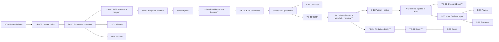

# Implementation Plan — CASCADE

> **As-built note:** implementation details that changed during the build are recorded in [`AsBuilt.md`](AsBuilt.md); where this page and the code disagree, AsBuilt.md is authoritative.

> Ticket-level work breakdown with owners, estimates, dependencies, files and acceptance criteria.
> Phase goals & gates: [`Phases.md`](Phases.md) · Rules every ticket follows: [`Rules.md`](Rules.md).
> Estimates are focused engineering hours. **Owner:** A = Data/Sim · B = ML · C = Platform · D = UX & Report.
> **Priority:** P0 = required for the minimum complete submission · P1 = value-add · P2 = future.

---

## 0. Dependency Map (critical path in bold)

---

## Phase 0 — Foundations & Contracts

| ID | Title | Pri | Owner | Est | Depends | Files |
|---|---|---|---|---|---|---|
| P0-01 | Repo skeleton & tooling | P0 | C | 1.0h | — | `pyproject.toml`, `uv.lock`, `.pre-commit-config.yaml`, `.importlinter`, `ruff`/`mypy` config, `src/cascade/__init__.py`, `.gitignore`, `.env.example` |
| P0-02 | Domain definitions | P0 | B | 1.0h | P0-01 | `domain/stages.py`, `domain/delay.py`, `domain/ports.py`, `tests/unit/test_delay.py` |
| P0-03 | Schemas & contracts | P0 | B+C | 1.0h | P0-02 | `domain/schemas.py` (Pydantic), `data/validation.py` (Pandera), `models/artifacts.py` (manifest model), `features/registry.py` skeleton |
| P0-04 | CLI skeleton | P0 | C | 0.5h | P0-01 | `cli.py` (Typer: generate/train/evaluate/publish/serve/report/all) |
| P0-05 | CI pipeline | P0 | C | 0.5h | P0-01 | `.github/workflows/ci.yml` (matrix ubuntu + windows; lint, mypy, pytest, import-linter) |
| P0-06 | Config system | P0 | C | 0.5h | P0-01 | `config.py`, `configs/{sim,train,serve}.yaml` |

**Acceptance criteria**
- **P0-02:** `compute_increments(planned, actual)` returns Δ per stage; Hypothesis test: for random monotone timelines, `Σ Δ == delay(DELIVERED)` and the ETA identity hold. Direct routes produce no TS stages.
- **P0-03:** `PredictRequest` rejects naive datetimes, observed events after `as_of`, and non-monotone actuals (422 tests). The manifest model has `feature_hash`, `data_hash`, `config_hash`, `git_sha`, `metrics`, `files{sha256}`.
- **P0-05:** CI completes in < 6 min on both OSes; a failing import boundary breaks the build.

---

## Phase 1 — Data, Definitions & Ground Truth

### Workstream A — Simulator (`src/cascade/sim/`)

| ID | Title | Pri | Est | Depends | Files |
|---|---|---|---|---|---|
| A-01 | Port network, lanes, carriers, calendars | P0 | 1.5h | P0-03 | `sim/network.py`, `configs/sim.yaml` |
| A-02 | External series (congestion, weather) + as-of forecast | P0 | 1.5h | A-01 | `sim/external.py` |
| A-03 | Schedule planner (planned timestamps per lane, weekly hub services) | P0 | 1.0h | A-01 | `sim/mechanics.py::plan_shipment` |
| A-04 | Stage mechanics with cause ledger | P0 | 3.0h | A-02, A-03 | `sim/mechanics.py`, `sim/ledger.py` |
| A-05 | Missingness (structural/MCAR/MNAR) + timestamp jitter | P0 | 1.0h | A-04 | `sim/missingness.py` |
| A-06 | Generator orchestration + IO + invariants | P0 | 1.0h | A-05 | `sim/generator.py`, `data/io.py` |
| A-07 | SCM intervention API (inject +δ at stage i; apply action) with the same RNG stream | P1 | 1.5h | A-04 | `sim/generator.py::resimulate` |
| A-08 | EDA notebook + data figures for report | P0 | 1.0h | A-06 | `notebooks/01_eda.ipynb`, `reports/figures/data_*.png` |

**Acceptance criteria**
- **A-04:** Each mechanic has a unit test with a hand-computed scenario:
  - *missed connection:* hub arrival delay 20 h, buffer 12 h, handling 4 h → Δ_TS ≈ +headway (168 h) and ledger cause `missed_connection`.
  - *berth window:* arrival delay 15 h > tolerance 12 h at ρ=0.9 → wait ×(1+λ·0.9).
  - *customs calendar:* release computed Fri 19:00 local at a port with no weekend customs → shifted to Mon 08:00, ledger `weekend_holiday_closure` = 61 h.
  - *ocean recovery:* incoming delay 40 h, κ=0.25, cap 18 h → recovery −10 h.
- **A-04:** For every shipment, `Σ ledger.hours == total_delay_h` (±1 min).
- **A-05:** Direct lanes have no TS events and are never counted as missing. The MCAR drop rate is within ±2 pp of config. `DELIVERED` is never dropped.
- **A-06:** `cascade generate --n 300 --seed 42` takes < 10 s, is deterministic (identical file hashes across two runs), passes Pandera, and gives a late rate in [25%, 45%].
- **A-07:** Re-simulating with δ=0 reproduces the original timelines exactly.

### Workstream B — Snapshots, splits, baselines, evaluation

| ID | Title | Pri | Est | Depends | Files |
|---|---|---|---|---|---|
| B-01 | As-of snapshot builder (checkpoints, imputation, overdue bound) | P0 | 3.0h | P0-03, A-06 | `features/snapshot.py` |
| B-01a | Leakage property tests | P0 | 1.0h | B-01 | `tests/property/test_no_leakage.py` |
| B-02 | Splits: out-of-time test + GroupKFold(voyage) + calibration voyages; frozen JSON | P0 | 0.5h | B-01 | `data/splits.py` |
| B-03 | Baselines B0/B1/B2 + evaluation harness (metrics by checkpoint, bootstrap CIs, figures) | P0 | 3.0h | B-02 | `models/baselines.py`, `eval/metrics.py`, `eval/backtest.py`, `eval/figures.py` |

**Acceptance criteria**
- **B-01:** Checkpoints are generated per Design §4. `lower_bound_delay` is correct when the next event is overdue. Single-row build < 1.5 ms (pytest-benchmark).
- **B-01a:** Hypothesis perturbs future actuals/externals/ledger → the feature row is bit-identical (≥ 200 examples).
- **B-02:** No `voyage_id` appears in two folds; the test set is the latest 20% by planned departure; the split JSON is committed per seed.
- **B-03:** `cascade evaluate` writes `reports/metrics.json` with MAE/RMSE/MedAE/P90AE per checkpoint, PR-AUC/ROC-AUC/Brier, and 95% bootstrap CIs (1,000 resamples, shipment-level), plus `convergence_curve.png`.

### Workstream C — API skeleton

| ID | Title | Pri | Est | Depends | Files |
|---|---|---|---|---|---|
| C-01 | FastAPI app: lifespan loading, `/health`, `/ready`, `/v1/model`, `/v1/predict` (B2 model), RFC 7807, request-ID + Server-Timing middleware, orjson | P0 | 3.0h | P0-03 | `serving/app.py`, `serving/routes/`, `serving/middleware.py`, `serving/problems.py` |
| C-01a | Fallback chain + timeout wrapper | P0 | 1.0h | C-01 | `serving/fallback.py`, `serving/service.py` |
| C-01b | Contract tests (OpenAPI snapshot) | P0 | 0.5h | C-01 | `tests/contract/test_openapi.py` |

**Acceptance criteria**
- **C-01:** `/ready` returns 503 until the bundle is verified and warmed up. Every response has the `X-Request-ID`, `X-Model-Version` and `Server-Timing` headers.
- **C-01a:** An injected booster exception → 200 with `flags.degraded=true, reason="model_error"` from B2. An unknown lane in B2 → schedule fallback. Test covers both.

### Workstream D — UI shell

| ID | Title | Pri | Est | Depends | Files |
|---|---|---|---|---|---|
| D-01 | Streamlit shell: theme tokens, navigation, API client with caching & error states | P0 | 2.0h | C-01 stub | `app/Home.py`, `app/theme.py`, `app/api_client.py` |
| D-02 | Fleet Overview v1 (table + KPI tiles) on API data | P0 | 2.0h | D-01 | `app/pages/1_Fleet.py` |

**Acceptance criteria:** Pages render in < 2 s against demo data. API-down shows a friendly error state, not a traceback. Risk tiers use colour plus icon.

---

## Phase 2 — Intelligence

### Workstream B — Features, models, explanations

| ID | Title | Pri | Est | Depends | Files |
|---|---|---|---|---|---|
| B-04 | Plan & progress features | P0 | 1.5h | B-01 | `features/families/plan.py`, `progress.py` |
| B-05 | **Propagation features** (buffer remaining, p_miss prior, queue wait, congestion×lateness, customs weekend risk, rail wait, absorption) | P0 | 2.5h | B-04, A-02 | `features/families/propagation.py` |
| B-06 | External features (realized vs forecast by as-of) | P0 | 0.5h | B-01 | `features/families/external.py` |
| B-07 | OOF smoothed priors (lane/port/carrier/hub) | P0 | 1.0h | B-02 | `features/priors.py` |
| B-08 | Data-quality features | P0 | 0.5h | B-01 | `features/families/quality.py` |
| B-09 | LightGBM quantile models + monotone constraints; target ablation (remaining vs residual-over-B2) | P0 | 2.5h | B-04..B-08 | `models/gbm.py`, `configs/train.yaml` |
| B-10 | Late classifier + isotonic calibration | P0 | 1.0h | B-09 | `models/classifier.py` |
| B-11 | CQR conformal per checkpoint group + guardrails (sort, lower bound, clamp) | P0 | 1.5h | B-09 | `models/conformal.py`, `models/pipeline.py` |
| B-12 | Stage-chain models + reconciliation | P1 | 2.0h | B-09 | `models/stage_chain.py`, `models/reconcile.py` |
| B-13 | Stage-grouped contributions (`pred_contrib`), waterfall, narrative templates (ops/customer/analyst) | P0 | 3.0h | B-11 | `explain/contributions.py`, `stage_groups.py`, `waterfall.py`, `narrative.py` |
| B-14 | Attribution-fidelity evaluator (+ route-prior & random explainer baselines, cause confusion matrix) | P0 | 1.5h | B-13 | `eval/attribution_fidelity.py` |
| B-15 | Artifact publish with quality gates + manifest | P0 | 1.0h | B-11 | `models/artifacts.py`, `cli.py::publish` |
| B-16 | Optuna tuning (30 trials, grouped CV) | P1 | 1.0h | B-09 | `models/tune.py` |

**Acceptance criteria**
- **B-05:** Unit tests: `ts_buffer_remaining_h < 0` whenever the projected hub-ready time exceeds the cut-off; `customs_weekend_risk=1` for the Fri-19:00 fixture; every propagation feature is registered with stage group + monotone sign.
- **B-07:** A test proves the prior for a row in fold k is computed without fold k's shipments.
- **B-09:** Grouped-CV MAE beats B2. Ablation table (−propagation, −priors, −quality) saved to `reports/ablations.json`. Inference for 4 boosters on one row < 1 ms.
- **B-10:** Reliability diagram ECE ≤ 0.05 on OOF; Brier ≤ 0.15 on test.
- **B-11:** Test coverage 80% ± 5 pp per checkpoint group. Property test: P10 ≤ P50 ≤ P90 and P10 ≥ lower bound for random inputs.
- **B-13:** `Σ stage contributions + base == P50` within 0.1 h for 100% of test rows. Narrative numbers ⊆ explanation facts (regex test). Customer audience contains no carrier/terminal/feature names. `/predict` explain overhead p95 < 8 ms.
- **B-14:** Reports top-1/top-2 accuracy vs the ledger for future-stage root causes at pre-arrival checkpoints, alongside the two baseline explainers. Target ≥ 70%.
- **B-15:** `cascade publish` refuses a bundle that fails any hard gate (Rules §4.4), with a clear message. A passing bundle is written to `artifacts/vX.Y.Z/` with checksums.

### Workstream C — Real model in API + decision layer

| ID | Title | Pri | Est | Depends | Files |
|---|---|---|---|---|---|
| C-02 | Load published bundle (verify checksums + feature hash), warm-up, `/v1/predict`, `/v1/predict/batch`, `/v1/explain` | P0 | 2.0h | B-15 | `serving/service.py`, `models/pipeline.py` |
| C-03 | Perf tests (pytest-benchmark) + locust profile | P0 | 1.0h | C-02 | `tests/perf/`, `tests/perf/locustfile.py` |
| C-04 | Demo data endpoint `/v1/shipments/{id}` (test-set snapshots) | P0 | 0.5h | C-02 | `serving/routes/shipments.py` |
| C-05 | Promise ETA with hysteresis | P1 | 1.0h | C-02 | `decision/promise.py` |
| C-06 | Cost-of-delay model | P1 | 1.0h | C-02, B-12 (optional) | `decision/cost.py`, `configs/costs.yaml` |
| C-07 | Alert rules + dedupe | P1 | 1.5h | C-05 | `decision/alerts.py`, `configs/alerts.yaml` |
| C-08 | Async SQLite ledger (predictions, promises, alerts, actuals) + `/v1/alerts`, `/v1/monitoring/accuracy` | P1 | 2.0h | C-07 | `decision/ledger.py`, `serving/routes/monitoring.py` |

**Acceptance criteria**
- **C-02:** Feature-hash mismatch → the service refuses to become ready (test). Batch of 1,000 < 1 s. `?audience=` is honoured.
- **C-03:** CI asserts p95 < 50 ms single predict (in-process ASGI client), 200 sequential requests after warm-up.
- **C-05:** Replay over the test set: promise flip rate ≤ 40% of raw P50 date changes; promise hit rate ≥ 78%. Property: identical consecutive predictions never change the promise.
- **C-06:** Unit tests: free-time boundary (exactly 4.0 days → $0), tiered rates, missed-appointment triggered only when delay > window.
- **C-07:** Replay yields alert lead time ≥ 48 h for ≥ 70% of late shipments. No duplicate open alerts per rule/shipment.
- **C-08:** Ledger writes never block the request (a test with an artificially slow writer: p95 unchanged); queue overflow increments a counter, and the response is still 200.

### Workstream D — Core UX

| ID | Title | Pri | Est | Depends | Files |
|---|---|---|---|---|---|
| D-03 | **Shipment Detail hero page**: ETA card, narrative + copy button, Gantt (planned/actual/forecast + P10–P90), **time-travel slider**, waterfall (solid vs hatched), stage drivers with expandable features, data-quality chip | P0 | 5.0h | C-02 | `app/pages/2_Shipment.py`, `app/components/{timeline,waterfall,eta_card}.py` |
| D-04 | Fleet Overview v2: risk sort, filters, route map (geo arcs by P(late)), Promise ETA + trust stars | P0 | 2.5h | C-02 | `app/pages/1_Fleet.py`, `app/components/route_map.py` |

**Acceptance criteria**
- **D-03:** Scrubbing the time-travel slider updates every panel in < 1 s (cached). The waterfall total equals the ETA card's P50 delay. Degraded responses show a "Reduced confidence" chip with the reason.
- **D-04:** Sorting by P(late) and filtering by lane/carrier/tier work; the map renders hubs sized by propagation factor.

---

## Phase 3 — Product, Proof & Polish

| ID | Title | Pri | Owner | Est | Depends | Files |
|---|---|---|---|---|---|---|
| B-17 | Propagation matrix: model Φ̂ vs SCM Φ_true + `/v1/insights/propagation` | P1 | B | 2.0h | A-07, B-11 | `explain/propagation.py` |
| B-18 | Intervention Advisor + advisor fidelity vs true SCM interventions + `/v1/advise` | P1 | B+C | 3.0h | A-07, C-06 | `decision/advisor.py`, `explain/counterfactual.py` |
| C-09 | Disruption Impact Radar + presets + `/v1/scenarios/impact` | P1 | C | 2.0h | C-02 | `decision/scenarios.py` |
| B-19 | Decision-metrics replay (alert lead time, promise flip/hit, cost calibration) | P1 | B | 1.0h | C-05..C-07 | `eval/decision_metrics.py` |
| B-20 | Robustness (dropout 10/30/50%, noise sweep), learning curve, 5-seed stability | P1 | B | 2.0h | B-15 | `eval/robustness.py` |
| D-05 | What-If & Scenario Lab page | P1 | D | 2.5h | B-18, C-09 | `app/pages/3_WhatIf_Scenarios.py` |
| D-06 | Alerts Inbox + Data Feed Health pages | P1 | D | 2.0h | C-08 | `app/pages/4_Alerts.py`, `6_Data_Health.py` |
| D-07 | Model & Network Insights page (convergence, calibration, coverage, fidelity, propagation heatmap, global stage SHAP) | P0 | D | 2.5h | B-14, B-17 | `app/pages/5_Insights.py` |
| C-10 | Hardening: schemathesis fuzz, golden tests, `/metrics`, input limits | P1 | C | 2.0h | C-02 | `tests/contract/`, `tests/golden/` |
| C-11 | Docker multi-stage images + compose + healthchecks | P1 | C | 1.5h | C-02, D-03 | `docker/` |
| B-21 | Model card generator | P1 | B | 0.5h | B-20 | `eval/model_card.py` → `docs/ModelCard.md` |
| D-08 | **Technical report (2–3 pages PDF)** | P0 | D+B | 4.0h | B-14 | `report/report.typ`, `report/figures/` |
| D-09 | README (quick start, architecture, results table, screenshots) | P0 | D | 1.0h | all P0 | `README.md` |
| D-10 | Demo video ≤ 5 min (script in Phases §7.2) | P1 | D | 2.0h | D-03..D-07 | external link |

**Acceptance criteria**
- **B-17:** Spearman ρ(Φ̂, Φ_true) is reported; the expected qualitative pattern holds (Φ<1 on long ocean legs, Φ≫1 at hub cut-offs).
- **B-18:** Only feasible actions are returned (rule tests). Advisor fidelity = rank correlation of model-estimated vs SCM-true hours saved, reported. p95 < 150 ms.
- **C-09:** 1,000 shipments re-scored in < 1 s; Δ late count matches a brute-force loop (test).
- **B-20:** Degradation curve saved; 5-seed mean ± sd for headline metrics in `metrics.json`.
- **C-10:** schemathesis finds no 5xx on 500 generated cases.
- **C-11:** `docker compose up --build` on a clean machine → both services healthy in < 2 min; images run as non-root.
- **D-08:** ≤ 3 pages; includes definitions, ground-truth construction, the results table with CIs, the convergence figure, one worked waterfall example and limitations.
- **D-09:** A reviewer can go from clone to running UI in ≤ 3 commands.

---

## 4. Test Plan Summary

| Layer | What | Tool | Gate |
|---|---|---|---|
| Domain | Delay math identities | pytest + Hypothesis | CI |
| Simulator | Mechanic scenarios, ledger sums, determinism | pytest | CI |
| Features | No leakage, OOF priors, registry completeness | Hypothesis | CI |
| Models | Quantile order, lower bound, coverage, gates | pytest | `cascade publish` |
| Explain | Additivity, narrative facts, audience redaction | pytest | CI |
| Decision | Hysteresis, cost boundaries, alert dedupe, feasibility | pytest + Hypothesis | CI |
| API | Contract snapshot, fuzzing, fallback, readiness | pytest + schemathesis | CI |
| Perf | p95 single/batch, non-blocking ledger | pytest-benchmark, locust | CI (single) / manual (locust) |
| E2E | `cascade all --n 120` | pytest integration | CI |
| UI | Smoke: each page renders against the fixture API | `streamlit.testing.AppTest` | CI |

---

## 5. Risk Register

| # | Risk | Prob. | Impact | Mitigation | Trigger → Action |
|---|---|---|---|---|---|
| 1 | Simulator takes longer than planned | M | H | Build the 4 core mechanics first; others behind config flags | A-04 > 4 h → drop rail cut-off & receiving windows |
| 2 | Model doesn't beat B2 by enough | M | H | B2 is a strong, honest baseline; residual target; propagation features | Gate 2 miss → report honestly, focus on calibration + explanations |
| 3 | Coverage off at early checkpoints | M | M | CQR per group; merge groups if n is small | Group n < 40 → merge with the neighbouring group |
| 4 | Latency over budget due to SHAP | L | M | `pred_contrib` in C++; top-k only | p95 > 50 ms → reduce trees, cache priors, skip explain on batch |
| 5 | UI time sink | H | M | Hero page first; components reused | D-03 > 6 h → cut Data Health page |
| 6 | Windows/Linux env drift | M | M | uv lockfile, CI matrix | CI red on Windows → fix before features |
| 7 | Over-scoping the decision layer | M | M | Strict P1 ordering; pure functions | Day-3 noon not at minimum submission → freeze scope |
| 8 | Reviewer suspects synthetic "too easy" | M | H | Noise, latent confounder, MNAR, out-of-time Q4 test, limitations section | — |

---

## 6. Effort Summary

| Phase | P0 hours | P1 hours | Total |
|---|---|---|---|
| Phase 0 | 4.5 | — | 4.5 |
| Phase 1 | 26.0 | 1.5 | 27.5 |
| Phase 2 | 27.5 | 8.5 | 36.0 |
| Phase 3 | 7.5 | 20.5 | 28.0 |
| **Total** | **65.5** | **30.5** | **96.0** |

With four parallel workstreams this is about 24 h per person over 3 days, which is comfortable. **Solo:** the P0 scope (≈ 65 h of focused work) is too much for one person in 72 hours, so follow the critical path in `Phases.md` §8. Simplify A-04 to the 4 core mechanics, and take P1 items only after the minimum complete submission.

---

## 7. Day-by-Day Checklist (team mode)

**Day 1**
- [ ] P0-01..P0-06 merged; interface freeze signed off
- [ ] A-01..A-06 merged; 300 shipments generated and validated
- [ ] B-01, B-01a, B-02, B-03 merged; baseline scoreboard published
- [ ] C-01, C-01a, C-01b merged; D-01, D-02 merged
- [ ] **Gate 1 review**

**Day 2**
- [ ] B-04..B-11, B-13..B-15 merged; first bundle `v1.0.0` published
- [ ] C-02..C-04 merged; C-05..C-08 merged (P1)
- [ ] D-03, D-04 merged
- [ ] **Gate 2 review**

**Day 3**
- [ ] B-17..B-21, C-09..C-11 (P1 by priority)
- [ ] D-05..D-07 merged; D-08 report PDF; D-09 README; D-10 demo
- [ ] Final `cascade all` reproducibility check; tag `v1.0.0`
- [ ] **Gate 3 review** → candidate sends submission email (repo link, PDF, demo) to the address in the brief
